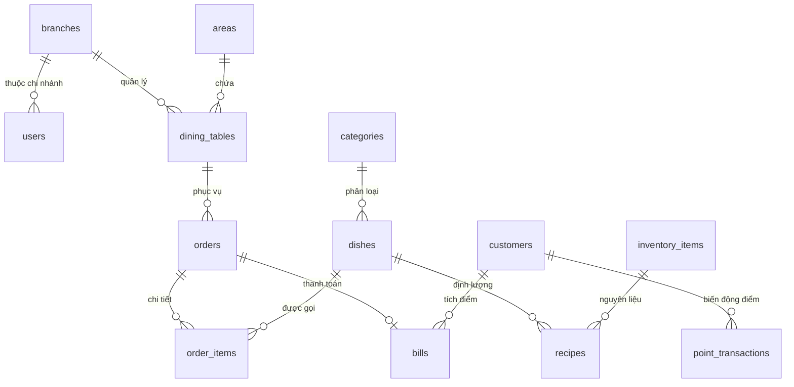
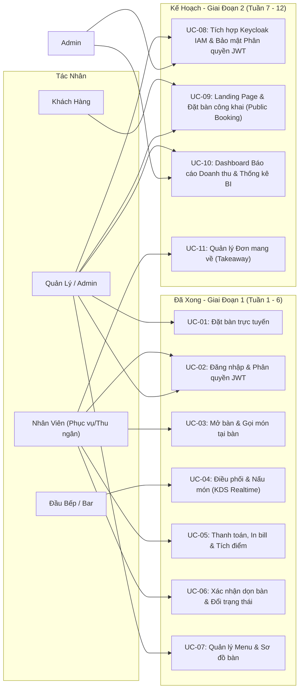
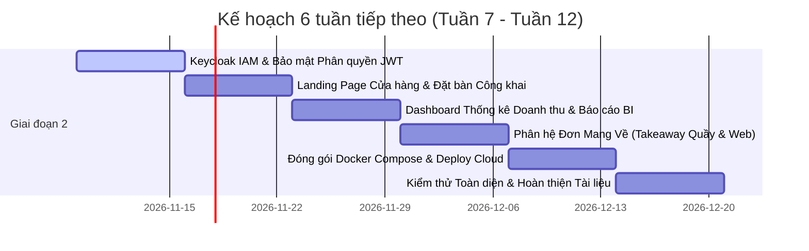

# BÁO CÁO TIẾN ĐỘ ĐỒ ÁN 3 (GIỮA KỲ - TUẦN 6/12)

**ĐỀ TÀI: THIẾT KẾ VÀ XÂY DỰNG HỆ THỐNG QUẢN LÝ NHÀ HÀNG & ĐIỀU PHỐI BẾP THÔNG MINH (NOM NOM HUB)**

- **Trường:** Đại học Bách Khoa Hà Nội (HUST) - Trường Công nghệ Thông tin & Truyền thông
- **Học phần:** Đồ án 3 (IT3930 / IT3940)
- **Thời lượng thực hiện:** 12 tuần (Đã hoàn thành: Tuần 1 - 6 | Kế hoạch: Tuần 7 - 12)
- **Sinh viên thực hiện:** [Họ và tên sinh viên] - MSSV: [Mã số sinh viên]
- **Giảng viên hướng dẫn:** [Họ và tên Thầy/Cô hướng dẫn]

---

## 1. TỔNG QUAN TIẾN ĐỘ DỰ ÁN

| Giai đoạn | Thời gian | Trọng tâm công việc | Tình trạng |
| :--- | :---: | :--- | :---: |
| **Giai đoạn 1 (Đã hoàn thành)** | Tuần 1 - 6 | Phân tích nghiệp vụ, thiết kế CSDL (23 bảng), xây dựng Core Backend REST API, xác thực JWT, đồng bộ thời gian thực WebSocket (STOMP), màn hình POS phục vụ, màn hình điều phối bếp (KDS), thuật toán xếp lịch bếp thông minh, quy trình thanh toán & dọn bàn. | **100% Hoàn thành** |
| **Giai đoạn 2 (Kế hoạch tiếp theo)** | Tuần 7 - 12 | Nghiên cứu Keycloak IAM & phân quyền JWT Stateless, Landing Page & Đặt bàn công khai (Public Booking), Dashboard báo cáo doanh thu & biểu đồ phân tích (BI), hoàn thiện phân hệ đơn mang về (Takeaway), đóng gói Docker & triển khai Cloud, kiểm thử và làm tài liệu. | **Sẵn sàng triển khai** |

---

## 2. KIẾN TRÚC KỸ THUẬT HỆ THỐNG (SYSTEM ARCHITECTURE)

Hệ thống được xây dựng theo mô hình kiến trúc phân tầng (Layered Architecture) hiện đại, phân tách độc lập giữa Client và Server:

```
[ FRONTEND - Angular 17 SPA ] 
       │ 
       ├── HTTPS / REST APIs ──────────┐
       └── WSS / STOMP (WebSocket) ────┤
                                       ▼
                       [ BACKEND - Spring Boot 3 Core ]
                       ├── Security Filter (JWT Stateless)
                       ├── REST Controllers (POS, KDS, Admin)
                       ├── WebSocket Broker (SimpMessaging)
                       ├── Smart Scheduling Engine (Thuật toán KDS)
                       └── Data Access Layer (Spring Data JPA)
                                       │
                                       ▼
                       [ DATABASE - PostgreSQL 16 (Neon Cloud) ]
                       └── 23 Bảng chuẩn hóa 3NF, Foreign Keys & Indexes
```

- **Frontend (FE):**
  - **Framework:** **Angular 17+** (Standalone Components, TypeScript).
  - **Quản lý bất đồng bộ & State:** RxJS, Signals, Reactive Forms.
  - **Giao tiếp Realtime:** `@stomp/stompjs` kết nối WebSocket STOMP.
  - **Giao diện:** Thiết kế Responsive (Dark Theme hiện đại tối ưu cho môi trường ánh sáng bếp và quầy thu ngân), PrimeNG & CSS Modules tùy biến.
- **Backend (BE):**
  - **Nền tảng:** **Java 17/21 + Spring Boot 3.x**.
  - **Bảo mật (Auth Core):** Spring Security 6 kết hợp JWT (JSON Web Token) phân quyền không lưu phiên (Stateless Authentication).
  - **Realtime Broker:** Spring WebSocket + STOMP Messaging xử lý đẩy dữ liệu 2 chiều cực nhanh (< 50ms) giữa POS và KDS.
  - **ORM / Persistence:** Spring Data JPA / Hibernate, HikariCP Connection Pool.
  - **Tài liệu API:** Swagger / OpenAPI 3 tích hợp sẵn.
- **Cơ sở dữ liệu (Database):**
  - **Hệ quản trị CSDL:** **PostgreSQL 16** (triển khai trên nền tảng Cloud Serverless **Neon.tech**).
  - Đảm bảo trọn vẹn các thuộc tính **ACID** trong các giao dịch trừ điểm, đổi trạng thái bàn và xuất hóa đơn.

---

## 3. HIỆN TRẠNG CƠ SỞ DỮ LIỆU (DATABASE STATUS)

- **Tình trạng:** **ĐÃ HOÀN THIỆN 100%** thiết kế logic và vật lý. Script DDL `schema.sql` đã khởi tạo và nạp dữ liệu mẫu thành công. Toàn bộ 23 thực thể đã được ánh xạ thành các **JPA Entity Class** trong backend (`com.restaurant.app.entity`).
- **Danh sách 23 bảng thực thể theo phân hệ nghiệp vụ:**



1. **Phân hệ Tổ chức & Người dùng:**
   - `branches`: Quản lý chi nhánh (hỗ trợ kiến trúc mở rộng chuỗi).
   - `users`: Tài khoản nhân viên, mã hóa mật khẩu BCrypt, phân quyền Role.
   - `restaurant_configs`: Cấu hình hệ thống (tỷ lệ tích điểm, VAT, thông tin quán).
2. **Phân hệ Không gian & Bàn ăn:**
   - `areas`: Khu vực/tầng (Tầng 1, Tầng 2, Sân vườn, Phòng VIP).
   - `dining_tables`: Bàn ăn (`EMPTY`, `OCCUPIED`, `CLEANING`, `RESERVED`), sức chứa.
   - `reservations`: Thông tin khách đặt bàn trước qua Web/Điện thoại.
3. **Phân hệ Thực đơn (Menu):**
   - `categories`: Phân loại món ăn (Khai vị, Món chính, Đồ uống, Tráng miệng).
   - `dishes`: Món ăn, giá gốc, giá bán, trạm bếp (`KITCHEN_HOT`, `KITCHEN_COLD`, `BAR`), ảnh Cloudinary, thời gian nấu chuẩn (`prep_time_minutes`).
4. **Phân hệ Đơn hàng & Bếp (Order & KDS):**
   - `orders`: Đơn hàng gắn với bàn hoặc đơn mang về, trạng thái tổng thể.
   - `order_items`: Chi tiết từng món gọi, số lượng, ghi chú, trạng thái chế biến (`PENDING`, `COOKING`, `READY`, `SERVED`).
5. **Phân hệ Khách hàng & Thanh toán:**
   - `customers`: Hồ sơ khách hàng, số điện thoại, điểm tích lũy hiện có.
   - `vouchers`: Mã giảm giá (% hoặc số tiền cố định, thời hạn sử dụng).
   - `bills`: Hóa đơn thanh toán, tổng tiền, giảm giá voucher, trừ điểm, hình thức thanh toán (`CASH`, `TRANSFER`, `POS`).
   - `point_transactions`: Lịch sử cộng/trừ điểm minh bạch.
6. **Phân hệ Kho & Ca làm việc (Sẵn sàng cho Giai đoạn 2):**
   - `inventory_items`, `stock_receipts`, `stock_receipt_details`, `stock_issues`, `stock_issue_details`: Quản lý nhập/xuất/tồn kho nguyên liệu.
   - `recipes`: Công thức định lượng nguyên liệu cho từng món ăn.
   - `work_shifts`, `staff_unavailability`, `shift_assignments`: Xếp ca làm việc nhân sự.

---

## 4. PHÂN LUỒNG NGƯỜI DÙNG & MA TRẬN USE CASE (ACTORS & USE CASES)

### 4.1. Phân luồng vai trò người dùng (RBAC)
Hệ thống phân định ranh giới chức năng rõ ràng cho 4 vai trò nội bộ và 1 tác nhân khách bên ngoài:

| Tác nhân (Actor) | Mã quyền | Trách nhiệm & Phạm vi công việc |
| :--- | :--- | :--- |
| **Khách hàng (Guest)** | Public | Đặt bàn trực tuyến từ xa qua Web, xem thực đơn công khai. |
| **Chủ nhà hàng (Admin)** | `ROLE_ADMIN` | Toàn quyền hệ thống: quản lý tài khoản nhân viên, cấu hình tham số, theo dõi doanh thu tổng. |
| **Quản lý (Manager)** | `ROLE_MANAGER` | Quản lý thực đơn, chỉnh sửa giá/ảnh món, quản lý khu vực bàn, duyệt lịch đặt bàn, quản lý kho. |
| **Nhân viên (Staff)** | `ROLE_STAFF` | **Kiêm nhiệm Phục vụ & Thu ngân:** Xem sơ đồ bàn, mở bàn, gọi món tại bàn, gửi bếp, thanh toán hóa đơn, in bill, tích điểm, xác nhận dọn bàn. |
| **Đầu bếp / Pha chế (Chef)**| `ROLE_CHEF` | **Màn hình KDS:** Nhận món chế biến theo trạm, chuyển trạng thái nấu, báo hết món tức thì. |

### 4.2. Danh mục Use Case chính và Trạng thái hoàn thành



| Mã UC | Tên Use Case | Tác nhân chính | Tình trạng triển khai |
| :---: | :--- | :--- | :--- |
| **UC-01** | Quản lý Đặt bàn & Sắp xếp chỗ ngồi (Reservation Management) | Manager, Staff | **Đã hoàn thành** |
| **UC-02** | Đăng nhập & Xác thực phân quyền (Auth JWT) | Tất cả nhân viên | **Đã hoàn thành** |
| **UC-03** | Mở bàn, chọn món & gửi bếp (POS Dine-in) | Staff (Phục vụ) | **Đã hoàn thành** |
| **UC-04** | Nhận đơn, lập lịch & chế biến món (Smart KDS) | Chef (Bếp/Bar) | **Đã hoàn thành** |
| **UC-05** | Thanh toán, áp voucher, tích điểm & in bill | Staff (Thu ngân) | **Đã hoàn thành** |
| **UC-06** | Quản lý vòng đời bàn & Xác nhận dọn bàn | Staff, Manager | **Đã hoàn thành** |
| **UC-07** | Quản lý Thực đơn (Menu) & Khu vực bàn ăn | Manager, Admin | **Đã hoàn thành** |
| **UC-08** | Tìm hiểu & Tích hợp Keycloak IAM để bảo mật và phân quyền | Admin, Manager | *Kế hoạch Tuần 7* |
| **UC-09** | Xây dựng Landing Page & Cổng Đặt bàn công khai (Public Booking) | Khách hàng, Manager | *Kế hoạch Tuần 8* |
| **UC-10** | Báo cáo doanh thu & Dashboard phân tích BI | Admin, Manager | *Kế hoạch Tuần 9* |
| **UC-11** | Hoàn thiện Phân hệ Đơn Mua Mang Về (Takeaway Quầy/Web) | Staff, Khách hàng | *Kế hoạch Tuần 10* |

---

## 5. LUỒNG HOẠT ĐỘNG CHÍNH CỦA HỆ THỐNG (END-TO-END FLOW)

```
[1. Khách vào quán] 
       │
       ▼
[2. Phục vụ mở bàn trên POS] ──(Trạng thái bàn: Vàng - Đang ăn)
       │
       ▼
[3. Chọn món & Gửi bếp] 
       │ 
       ├── (Bắn sự kiện qua Spring WebSocket STOMP)
       ▼
[4. Màn hình Bếp KDS]
       ├── Thuật toán Lập lịch: Ưu tiên SLA bàn nhỏ (20-25p) vs bàn lớn (30p)
       ├── Đầu bếp nhận món -> Bấm "Bắt đầu nấu" -> Bấm "Nấu xong & Lên bàn"
       └── WebSocket thông báo ngược lại cho Phục vụ
       │
       ▼
[5. Phục vụ bưng món cho khách] ──(Cập nhật món: Đã lên bàn)
       │
       ▼
[6. Khách yêu cầu thanh toán]
       ├── Tra cứu SĐT khách hàng -> Tích/trừ điểm thành viên
       ├── Áp dụng Voucher (nếu có) -> Chọn PT thanh toán (Tiền mặt / QR chuyển khoản)
       ├── In hóa đơn tạm tính/hóa đơn nhiệt 80mm
       └── Xác nhận thanh toán thành công
       │
       ▼
[7. Tự động chuyển bàn sang DỌN DẸP] ──(Trạng thái bàn: Đỏ - Đang dọn)
       │
       ▼
[8. Nhân viên dọn xong -> Bấm xác nhận] ──(Trạng thái bàn: Xanh - Trống, sẵn sàng)
```

---

## 6. CÁC TÍNH NĂNG ĐÃ TRIỂN KHAI HOÀN TẤT (TUẦN 1 - 6)

1. **Xác thực & Bảo mật:** Đăng nhập JWT Stateless, cấp Access Token bảo mật, phân luồng điều hướng màn hình đúng theo vai trò của tài khoản.
2. **Sơ đồ bàn tương tác thời gian thực (Interactive Table Map):**
   - Trực quan hóa bàn theo từng Khu vực (Tầng 1, Tầng 2, Sân vườn, VIP).
   - Nhận diện 4 trạng thái qua màu sắc chuẩn hóa: **Xanh (Trống)**, **Vàng (Đang ăn)**, **Đỏ (Đang dọn bàn)**, **Tím (Đã đặt trước)**.
   - Thao tác mở bàn, gọi món và chuyển đổi trạng thái dọn dẹp với Popup xác nhận an toàn.
3. **Phân hệ Phục vụ & Gọi món (Mobile-friendly POS):**
   - Danh mục món trực quan theo từng tab (Khai vị, Món chính, Tráng miệng, Đồ uống).
   - Gọi món đa lựa chọn, thêm ghi chú riêng từng món (ít cay, không hành, giảm đá).
   - Cơ chế tự động khóa/mở form nhập liệu tránh người dùng sửa nhầm khi lưu mạng chậm.
   - Sau khi gửi bếp thành công, tự động chuyển về tab "Món đã gọi" để nhân viên tiện theo dõi tiến độ lên món.
4. **Màn hình Điều phối Bếp thông minh (KDS - Kitchen Display System):**
   - Bố cục 2 cột chuyên dụng tối ưu hiển thị (2/3 màn hình cho món **Đang nấu**, 1/3 màn hình cho món **Chờ chế biến**).
   - Grid thẻ vuông hiển thị tối đa 18 món trên 1 màn hình mà không cần cuộn trang, triệt tiêu nguy cơ sót món giờ cao điểm.
   - Lọc nhanh theo từng trạm chế biến: *Bếp Nóng*, *Bếp Lạnh*, *Quầy Bar*.
   - Tính năng "Báo Hết Món" 1-click từ bếp, đồng bộ khóa món ngay lập tức trên máy phục vụ.
5. **Thuật toán Lập lịch Bếp Độc quyền (Smart Kitchen Scheduling):**
   - **Phân bổ SLA theo quy mô bàn:** Ưu tiên nhẹ cho các bàn nhỏ (bàn 2-4 khách cam kết ra món trong 20-25 phút; bàn đông 8-12 khách điều phối trong 30 phút).
   - **Tuân thủ quy luật chuỗi món ăn:** Món Tráng miệng/Đồ ngọt tự động đưa về cuối chu trình bàn ăn, không bị nhảy trước món chính/món mặn.
   - **Ngăn chặn đói món (Starvation Prevention):** Món nào chờ quá lâu sẽ tự động tăng điểm ưu tiên đột biến để nổi lên đầu danh sách chế biến.
6. **Thanh toán, In Hóa đơn & Quản lý Khách hàng:**
   - Tính toán hóa đơn tự động, áp mã voucher giảm giá.
   - Tra cứu khách hàng theo SĐT, tích điểm theo tỷ lệ cấu hình, quy đổi điểm trừ tiền mặt.
   - Giao diện hóa đơn chuẩn in nhiệt 80mm.
7. **Quản lý Danh sách Đặt bàn (Table Reservation Management):** Tiếp nhận thông tin khách đặt bàn, theo dõi thời gian và xếp bàn trực quan tại quầy.

---

## 7. KẾ HOẠCH TRIỂN KHAI 6 TUẦN TIẾP THEO (TUẦN 7 - 12)



- **Tuần 7: Tìm hiểu và ứng dụng Keycloak để Bảo mật & Phân quyền (Keycloak IAM & Security)**
  - Tìm hiểu và sử dụng Keycloak để bảo mật và phân quyền: Nghiên cứu kiến trúc IAM (Identity & Access Management), tích hợp Keycloak Server với Spring Security 6 / OAuth2 Resource Server.
  - Xác thực & Bảo mật: Đăng nhập JWT Stateless, cấp Access Token bảo mật, phân luồng điều hướng màn hình đúng theo vai trò của tài khoản (Staff, Chef, Manager, Admin).
- **Tuần 8: Landing Page Cửa hàng & Đặt bàn Công khai (Landing Page & Public Booking)**
  - Xây dựng Landing Page chuyên nghiệp cho cửa hàng: Giới thiệu thương hiệu nhà hàng Nom Nom Hub, câu chuyện ẩm thực, không gian nhà hàng, thực đơn đặc sắc và nút kêu gọi hành động (CTA).
  - Đặt bàn công khai (Public Booking): Giao diện trực quan cho phép khách đặt bàn từ xa qua Internet (chọn ngày, giờ, số lượng khách, khu vực bàn, ghi chú) và nhân viên tiếp nhận phê duyệt.
- **Tuần 9: Phân hệ Báo cáo & Thống kê Quản trị (Dashboard & BI)**
  - Tích hợp thư viện biểu đồ trực quan (Chart.js / PrimeNG Charts).
  - Biểu đồ doanh thu theo ngày, tuần, tháng, so sánh giữa các ca làm việc.
  - Thống kê Top món bán chạy nhất (Best-sellers) và phân tích tỷ trọng phương thức thanh toán (Tiền mặt vs Quét mã QR).
- **Tuần 10: Hoàn thiện Phân hệ Bán Mang Về (Takeaway Module)**
  - Hoàn thiện Tab Đơn Mang Về tại quầy: cấp số thứ tự lấy đồ ngắn gọn (`#TKW-01`, `#TKW-02`), cơ chế thanh toán trước (*Pay-in-advance*).
  - Gắn nhãn badge màu cam `[MANG VỀ]` trên màn hình bếp KDS để đầu bếp đóng hộp chuyên dụng.
- **Tuần 11: Đóng gói Docker & Triển khai Hệ thống lên Cloud**
  - Viết `Dockerfile` tối ưu hóa đa tầng (Multi-stage build) cho Backend (Java 17 JRE Alpine) và Frontend (Nginx Alpine).
  - Cấu hình `docker-compose.yml` chạy đồng bộ Backend, Frontend, Nginx Reverse Proxy.
  - Deploy môi trường Production: Database (Neon PostgreSQL), Backend API (Render), Frontend SPA (Vercel).
- **Tuần 12: Kiểm thử và làm tài liệu**
  - Kiểm thử chức năng, kiểm thử tải (Stress testing) và kiểm thử luồng tích hợp End-to-End.
  - Hoàn thiện tài liệu Báo cáo Đồ án 3 chuẩn format học thuật HUST.
  - Thiết kế Slide thuyết trình và chuẩn bị kịch bản demo sản phẩm trước Hội đồng.

---

## 8. HỆ THỐNG THỰC TẾ THAM KHẢO & ĐIỂM SÁNG CÔNG NGHỆ

Dự án không chỉ dừng lại ở các bài toán CRUD quản lý đơn giản mà học hỏi trực tiếp từ các giải pháp F&B chuyên nghiệp trên thế giới và tại Việt Nam:

| Hệ thống tham khảo | Điểm học tập & Áp dụng vào Nom Nom Hub |
| :--- | :--- |
| **Toast POS (Hoa Kỳ)** | - Học tập kiến trúc phân tách luồng giữa POS và KDS qua WebSocket thời gian thực.<br>- Giao diện trực quan hóa trạng thái bàn bằng màu sắc nhận diện tức thì. |
| **QSR Automations (ConnectSmart KDS)** | - Học tập thuật toán gom mẻ (Greedy Batching) cho các món cùng loại trong cửa sổ thời gian ngắn.<br>- Cơ chế tính toán thời gian nấu đồng thời (*All Items Ready Together*) để các món ăn cho 1 bàn ra cùng thời điểm. |
| **Oracle MICROS Simphony** | - Học tập mô hình CSDL chuẩn hóa Enterprise (hỗ trợ trường `branch_id` mở rộng chuỗi đa chi nhánh).<br>- Phân quyền người dùng chặt chẽ theo vai trò (RBAC) và lưu vết giao dịch tài chính. |
| **CukCuk (MISA) & KiotViet** | - Kế thừa trải nghiệm người dùng thực tế tại các nhà hàng Việt Nam: phân chia khu vực tầng, in bill nhiệt khổ 80mm, tích hợp mã quét VietQR. |

**Các điểm sáng công nghệ nổi bật đã làm được trong Đồ án 3:**
1. **Giao tiếp Realtime cực nhanh:** Sự kết hợp giữa Spring WebSocket STOMP và Angular RxJS giúp đơn gọi món hiển thị trên màn hình bếp trong vòng chưa đầy 50ms, không cần reload trang.
2. **Thuật toán Điều phối Bếp thông minh:** Giải quyết được bài toán thực tế của nhà hàng: ưu tiên bàn nhỏ ra món nhanh (20-25p), giữ món tráng miệng làm sau, và tăng điểm ưu tiên chống đói món cho các món bị chờ lâu.
3. **Quy trình đóng kín bàn ăn hoàn chỉnh:** Tự động chuyển trạng thái "Đang dọn bàn" ngay sau khi in hóa đơn, bắt buộc xác nhận vệ sinh bàn trước khi mở đón khách mới.

---

## 9. KẾT LUẬN

Sau 6 tuần triển khai nghiêm túc, dự án **Nom Nom Hub** đã hoàn thành 100% khối lượng công việc của Giai đoạn 1, giải quyết trọn vẹn "xương sống" nghiệp vụ của một nhà hàng từ khâu tiếp đón khách, gọi món, điều phối bếp đến thanh toán và giải phóng bàn.

CSDL và kiến trúc được thiết kế bài bản sẵn sàng cho toàn bộ các tính năng nâng cao của Giai đoạn 2 (Tích hợp Keycloak IAM, Landing Page thương hiệu, Cổng Đặt bàn công khai, Báo cáo thống kê BI, Đơn mang về). Tiến độ thực tế hoàn toàn bám sát đề cương và cam kết sẽ hoàn thành xuất sắc đồ án đúng thời hạn 12 tuần.
