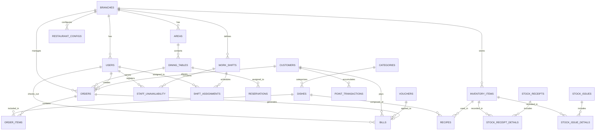

# TÀI LIỆU THIẾT KẾ CƠ SỞ DỮ LIỆU (DATABASE DESIGN)

## ĐỒ ÁN 3: HỆ THỐNG QUẢN LÝ NHÀ HÀNG (POSTGRESQL)

---

## 1. QUY ƯỚC THIẾT KẾ (NAMING CONVENTIONS & INTEGRITY)

- **Tên bảng & Tên cột:** Viết thường, phân cách bằng dấu gạch dưới (`snake_case`), danh từ số nhiều cho tên bảng (ví dụ: `dishes`, `orders`).
- **Khóa chính (Primary Key):** Đặt tên là `id`, kiểu số nguyên tự tăng `BIGSERIAL` (hoặc `BIGINT GENERATED ALWAYS AS IDENTITY`).
- **Khóa ngoại (Foreign Key):** Đặt tên theo cú pháp `<tên_bảng_số_ít>_id` (ví dụ: `branch_id`, `category_id`, `voucher_id`).
- **Thời gian (Timestamps):** Tất cả các bảng nghiệp vụ chính đều có `created_at` và `updated_at` (kiểu `TIMESTAMP WITH TIME ZONE DEFAULT CURRENT_TIMESTAMP`).
- **Giá tiền & Số lượng:**
  - Tiền tệ: `DECIMAL(12, 2)` tránh sai lệch số học.
  - Số lượng kho / Định lượng: `DECIMAL(10, 3)` (hỗ trợ các đơn vị như 0.5 kg, 1.25 lít).
  - Tỉ lệ phần trăm: `DECIMAL(5, 2)` (ví dụ: 10.50%).
- **An toàn dữ liệu lịch sử:** Các thực thể quan trọng (như món ăn, tài khoản nhân viên) không được xóa vật lý (`HARD DELETE`) mà sử dụng cờ xóa mềm (`is_deleted` / `is_active`) để bảo toàn nguyên vẹn lịch sử hóa đơn tài chính.

---

## 2. SƠ ĐỒ QUAN HỆ TỔNG QUAN (ERD - MERMAID)



---

## 3. CHI TIẾT CÁC BẢNG TRONG CƠ SỞ DỮ LIỆU (23 BẢNG)

---

### NHÓM 1: CẤU TRÚC HỆ THỐNG, TÀI KHOẢN & CẤU HÌNH

#### 3.1. Bảng `branches` (Chi nhánh nhà hàng)

> _Sẵn sàng mở rộng chuỗi nhà hàng sau này. Giai đoạn Đồ án 3 mặc định Chi nhánh 1._

| Tên trường   | Kiểu dữ liệu   | Ràng buộc                   | Mô tả                                   |
| :----------- | :------------- | :-------------------------- | :-------------------------------------- |
| `id`         | `BIGSERIAL`    | `PRIMARY KEY`               | Khóa chính                              |
| `name`       | `VARCHAR(150)` | `NOT NULL`                  | Tên chi nhánh (VD: Chi nhánh Bách Khoa) |
| `address`    | `VARCHAR(255)` | `NOT NULL`                  | Địa chỉ chi nhánh                       |
| `phone`      | `VARCHAR(20)`  | `NOT NULL`                  | Số điện thoại liên hệ                   |
| `is_active`  | `BOOLEAN`      | `DEFAULT TRUE`              | Trạng thái hoạt động                    |
| `created_at` | `TIMESTAMPTZ`  | `DEFAULT CURRENT_TIMESTAMP` | Thời gian tạo                           |
| `updated_at` | `TIMESTAMPTZ`  | `DEFAULT CURRENT_TIMESTAMP` | Thời gian cập nhật                      |

#### 3.2. Bảng `users` (Tài khoản nhân viên)

> _Phân quyền 4 nhóm: ADMIN, MANAGER, STAFF, CHEF._

| Tên trường      | Kiểu dữ liệu   | Ràng buộc                                                                             | Mô tả                          |
| :-------------- | :------------- | :------------------------------------------------------------------------------------ | :----------------------------- |
| `id`            | `BIGSERIAL`    | `PRIMARY KEY`                                                                         | Khóa chính                     |
| `branch_id`     | `BIGINT`       | `NOT NULL, FK -> branches(id)`                                                        | Thuộc chi nhánh nào            |
| `username`      | `VARCHAR(50)`  | `NOT NULL, UNIQUE`                                                                    | Tên đăng nhập                  |
| `password_hash` | `VARCHAR(255)` | `NOT NULL`                                                                            | Mật khẩu đã băm (BCrypt)       |
| `full_name`     | `VARCHAR(100)` | `NOT NULL`                                                                            | Họ và tên nhân viên            |
| `role`          | `VARCHAR(20)`  | `NOT NULL, CHECK (role IN ('ROLE_ADMIN', 'ROLE_MANAGER', 'ROLE_STAFF', 'ROLE_CHEF'))` | Quyền hạn tài khoản            |
| `phone`         | `VARCHAR(20)`  | `NULL`                                                                                | Số điện thoại                  |
| `is_active`     | `BOOLEAN`      | `DEFAULT TRUE`                                                                        | Trạng thái khóa / mở tài khoản |
| `created_at`    | `TIMESTAMPTZ`  | `DEFAULT CURRENT_TIMESTAMP`                                                           | Ngày tạo                       |
| `updated_at`    | `TIMESTAMPTZ`  | `DEFAULT CURRENT_TIMESTAMP`                                                           | Ngày sửa                       |

#### 3.3. Bảng `restaurant_configs` (Cấu hình hệ thống & Tham số vận hành)

> _Lưu các tham số động giúp thay đổi mà không cần sửa code. Có ràng buộc UNIQUE(branch_id, config_key)._

| Tên trường     | Kiểu dữ liệu   | Ràng buộc                       | Mô tả                                                                 |
| :------------- | :------------- | :------------------------------ | :-------------------------------------------------------------------- |
| `id`           | `BIGSERIAL`    | `PRIMARY KEY`                   | Khóa chính                                                            |
| `branch_id`    | `BIGINT`       | `NOT NULL, FK -> branches(id)`  | Áp dụng cho chi nhánh nào                                             |
| `config_key`   | `VARCHAR(100)` | `NOT NULL`                      | Khóa cấu hình (VD: `OPENING_TIME`, `CLOSING_TIME`, `EARN_POINT_RATE`) |
| `config_value` | `TEXT`         | `NOT NULL`                      | Giá trị cấu hình (VD: `08:00`, `22:30`, `100000`)                     |
| `description`  | `VARCHAR(255)` | `NULL`                          | Mô tả ý nghĩa tham số                                                 |
| `updated_at`   | `TIMESTAMPTZ`  | `DEFAULT CURRENT_TIMESTAMP`     | Thời gian sửa                                                         |
| **Ràng buộc**  | `UNIQUE`       | `UNIQUE(branch_id, config_key)` | Không trùng lặp key trong cùng 1 chi nhánh                            |

_Ví dụ các tham số cấu hình trong `restaurant_configs`:_

- `OPENING_TIME`: `08:00`
- `CLOSING_TIME`: `22:30`
- `DEFAULT_VAT_RATE`: `10.00` _(Thuế suất VAT mặc định 10.00%)_
- `EARN_POINT_RATE`: `100000` _(Tiêu 100.000 VNĐ được tích 1 điểm)_
- `REDEEM_POINT_RATE`: `1000` _(1 điểm quy đổi thành 1.000 VNĐ khi thanh toán)_
- `POINT_VALIDITY_DAYS`: `365` _(Điểm tích lũy có hạn trong 1 năm)_

---

### NHÓM 2: KHU VỰC, BÀN ĂN & ĐẶT BÀN (TABLES & RESERVATION)

#### 3.4. Bảng `areas` (Khu vực / Tầng)

| Tên trường   | Kiểu dữ liệu   | Ràng buộc                      | Mô tả                                         |
| :----------- | :------------- | :----------------------------- | :-------------------------------------------- |
| `id`         | `BIGSERIAL`    | `PRIMARY KEY`                  | Khóa chính                                    |
| `branch_id`  | `BIGINT`       | `NOT NULL, FK -> branches(id)` | Thuộc chi nhánh                               |
| `name`       | `VARCHAR(100)` | `NOT NULL`                     | Tên khu vực (VD: Tầng 1, Sân vườn, Phòng VIP) |
| `created_at` | `TIMESTAMPTZ`  | `DEFAULT CURRENT_TIMESTAMP`    | Thời gian tạo                                 |

#### 3.5. Bảng `dining_tables` (Bàn ăn)

| Tên trường     | Kiểu dữ liệu  | Ràng buộc                                                              | Mô tả                                    |
| :------------- | :------------ | :--------------------------------------------------------------------- | :--------------------------------------- |
| `id`           | `BIGSERIAL`   | `PRIMARY KEY`                                                          | Khóa chính                               |
| `area_id`      | `BIGINT`      | `NOT NULL, FK -> areas(id)`                                            | Thuộc khu vực nào                        |
| `table_number` | `VARCHAR(20)` | `NOT NULL`                                                             | Số bàn (VD: Bàn 01, VIP-02)              |
| `capacity`     | `INT`         | `NOT NULL, DEFAULT 4`                                                  | Sức chứa (số lượng ghế)                  |
| `status`       | `VARCHAR(20)` | `DEFAULT 'EMPTY', CHECK (status IN ('EMPTY', 'OCCUPIED', 'RESERVED'))` | Trạng thái: Trống, Đang có khách, Đã đặt |
| `created_at`   | `TIMESTAMPTZ` | `DEFAULT CURRENT_TIMESTAMP`                                            | Thời gian tạo                            |
| `updated_at`   | `TIMESTAMPTZ` | `DEFAULT CURRENT_TIMESTAMP`                                            | Thời gian sửa                            |

#### 3.6. Bảng `reservations` (Đặt bàn trước - Khách tự đặt Web hoặc Nhân viên ghi)

| Tên trường         | Kiểu dữ liệu    | Ràng buộc                                                                                 | Mô tả                                   |
| :----------------- | :-------------- | :---------------------------------------------------------------------------------------- | :-------------------------------------- |
| `id`               | `BIGSERIAL`     | `PRIMARY KEY`                                                                             | Khóa chính                              |
| `branch_id`        | `BIGINT`        | `NOT NULL, FK -> branches(id)`                                                            | Đặt tại chi nhánh nào                   |
| `table_id`         | `BIGINT`        | `NULL, FK -> dining_tables(id)`                                                           | Bàn được gán (Quản lý duyệt sẽ gán bàn) |
| `customer_name`    | `VARCHAR(100)`  | `NOT NULL`                                                                                | Tên người đặt                           |
| `phone`            | `VARCHAR(20)`   | `NOT NULL`                                                                                | SĐT người đặt                           |
| `guest_count`      | `INT`           | `NOT NULL, CHECK (guest_count > 0)`                                                       | Số lượng khách dự kiến                  |
| `reservation_time` | `TIMESTAMPTZ`   | `NOT NULL`                                                                                | Thời gian khách đến                     |
| `deposit_amount`   | `DECIMAL(12,2)` | `DEFAULT 0.00`                                                                            | Tiền đặt cọc (nếu có)                   |
| `status`           | `VARCHAR(20)`   | `DEFAULT 'PENDING', CHECK (status IN ('PENDING', 'CONFIRMED', 'CANCELLED', 'COMPLETED'))` | Trạng thái đặt bàn                      |
| `notes`            | `TEXT`          | `NULL`                                                                                    | Ghi chú (VD: Khách ăn sinh nhật)        |
| `created_at`       | `TIMESTAMPTZ`   | `DEFAULT CURRENT_TIMESTAMP`                                                               | Thời gian tạo yêu cầu                   |
| `updated_at`       | `TIMESTAMPTZ`   | `DEFAULT CURRENT_TIMESTAMP`                                                               | Thời gian cập nhật trạng thái           |

---

### NHÓM 3: THỰC ĐƠN & MÓN ĂN (MENU & DISHES)

#### 3.7. Bảng `categories` (Danh mục món)

| Tên trường      | Kiểu dữ liệu   | Ràng buộc          | Mô tả                                         |
| :-------------- | :------------- | :----------------- | :-------------------------------------------- |
| `id`            | `BIGSERIAL`    | `PRIMARY KEY`      | Khóa chính                                    |
| `name`          | `VARCHAR(100)` | `NOT NULL, UNIQUE` | Tên danh mục (Khai vị, Món chính, Đồ uống...) |
| `description`   | `VARCHAR(255)` | `NULL`             | Mô tả ngắn                                    |
| `display_order` | `INT`          | `DEFAULT 0`        | Thứ tự hiển thị trên Menu                     |
| `is_active`     | `BOOLEAN`      | `DEFAULT TRUE`     | Còn kinh doanh nhóm này không                 |

#### 3.8. Bảng `dishes` (Món ăn / Đồ uống - Hỗ trợ Xóa mềm, Đổi giá hẹn giờ & Thuật toán Lập lịch Bếp)

| Tên trường             | Kiểu dữ liệu    | Ràng buộc                                                                                   | Mô tả                                                               |
| :--------------------- | :-------------- | :------------------------------------------------------------------------------------------ | :------------------------------------------------------------------ |
| `id`                   | `BIGSERIAL`     | `PRIMARY KEY`                                                                               | Khóa chính                                                          |
| `category_id`          | `BIGINT`        | `NOT NULL, FK -> categories(id)`                                                            | Thuộc danh mục nào                                                  |
| `name`                 | `VARCHAR(150)`  | `NOT NULL`                                                                                  | Tên món ăn                                                          |
| `price`                | `DECIMAL(12,2)` | `NOT NULL, CHECK (price >= 0)`                                                              | Đơn giá hiện tại                                                    |
| `original_price`       | `DECIMAL(12,2)` | `NULL`                                                                                      | Giá niêm yết cũ (gạch ngang khuyến mãi trên Menu)                   |
| `scheduled_price`      | `DECIMAL(12,2)` | `NULL`                                                                                      | Giá mới đang chờ áp dụng                                            |
| `price_effective_date` | `DATE`          | `NULL`                                                                                      | Ngày giá mới có hiệu lực (ví dụ: ngày mai)                          |
| `preparation_time`     | `INT`           | `NOT NULL, DEFAULT 15, CHECK (preparation_time > 0)`                                        | **Thời gian nấu ước tính (phút)** (phục vụ thuật toán lập lịch bếp) |
| `station`              | `VARCHAR(30)`   | `DEFAULT 'KITCHEN_HOT', CHECK (station IN ('KITCHEN_HOT', 'KITCHEN_COLD', 'BAR', 'GRILL'))` | **Trạm chế biến:** Bếp nóng, Bếp nguội, Quầy Bar, Nướng             |
| `image_url`            | `VARCHAR(500)`  | `NULL`                                                                                      | Đường dẫn ảnh CDN (Cloudinary)                                      |
| `description`          | `TEXT`          | `NULL`                                                                                      | Mô tả thành phần, hương vị món                                      |
| `unit`                 | `VARCHAR(20)`   | `DEFAULT 'Đĩa'`                                                                             | Đơn vị: Đĩa, Bát, Nồi, Ly, Chai...                                  |
| `is_available`         | `BOOLEAN`       | `DEFAULT TRUE`                                                                              | Còn hàng hay Đã hết (bếp cập nhật realtime)                         |
| `is_deleted`           | `BOOLEAN`       | `DEFAULT FALSE`                                                                             | Xóa mềm: Ẩn khỏi Menu, không làm hỏng lịch sử hóa đơn               |
| `created_at`           | `TIMESTAMPTZ`   | `DEFAULT CURRENT_TIMESTAMP`                                                                 | Thời gian tạo                                                       |
| `updated_at`           | `TIMESTAMPTZ`   | `DEFAULT CURRENT_TIMESTAMP`                                                                 | Thời gian sửa                                                       |

---

### NHÓM 4: GỌI MÓN & VẬN HÀNH BẾP (ORDERS & KITCHEN)

#### 3.9. Bảng `orders` (Đơn gọi món - Hỗ trợ Khách vãng lai & Khách tích điểm)

| Tên trường      | Kiểu dữ liệu    | Ràng buộc                                                                               | Mô tả                                                  |
| :-------------- | :-------------- | :-------------------------------------------------------------------------------------- | :----------------------------------------------------- |
| `id`            | `BIGSERIAL`     | `PRIMARY KEY`                                                                           | Khóa chính                                             |
| `order_code`    | `VARCHAR(30)`   | `NOT NULL, UNIQUE`                                                                      | Mã đơn (VD: `ORD-20261103-001`)                        |
| `branch_id`     | `BIGINT`        | `NOT NULL, FK -> branches(id)`                                                          | Thuộc chi nhánh nào                                    |
| `table_id`      | `BIGINT`        | `NULL, FK -> dining_tables(id)`                                                         | Bàn ăn (NULL nếu là đơn mang về)                       |
| `staff_id`      | `BIGINT`        | `NOT NULL, FK -> users(id)`                                                             | Nhân viên tạo đơn                                      |
| `customer_id`   | `BIGINT`        | `NULL, FK -> customers(id)`                                                             | **NULL nếu khách không muốn tích điểm**                |
| `customer_name` | `VARCHAR(100)`  | `NULL`                                                                                  | Tên khách gọi tạm (tiện xướng tên khi giao đồ mang về) |
| `order_type`    | `VARCHAR(20)`   | `DEFAULT 'DINE_IN', CHECK (order_type IN ('DINE_IN', 'TAKE_AWAY'))`                     | Loại đơn: Tại bàn hoặc Mang về                         |
| `status`        | `VARCHAR(20)`   | `DEFAULT 'SERVING', CHECK (status IN ('PENDING', 'SERVING', 'COMPLETED', 'CANCELLED'))` | Trạng thái tổng quát của đơn                           |
| `total_amount`  | `DECIMAL(12,2)` | `DEFAULT 0.00`                                                                          | Tổng tiền món ăn tạm tính                              |
| `notes`         | `TEXT`          | `NULL`                                                                                  | Ghi chú chung cho đơn (VD: Khách vội, Gộp Bàn 01 + 02) |
| `created_at`    | `TIMESTAMPTZ`   | `DEFAULT CURRENT_TIMESTAMP`                                                             | Thời gian mở đơn                                       |
| `updated_at`    | `TIMESTAMPTZ`   | `DEFAULT CURRENT_TIMESTAMP`                                                             | Thời gian cập nhật                                     |

#### 3.10. Bảng `order_items` (Chi tiết món & Điều phối Bếp Realtime)

| Tên trường       | Kiểu dữ liệu    | Ràng buộc                                                                                             | Mô tả                                                           |
| :--------------- | :-------------- | :---------------------------------------------------------------------------------------------------- | :-------------------------------------------------------------- |
| `id`             | `BIGSERIAL`     | `PRIMARY KEY`                                                                                         | Khóa chính                                                      |
| `order_id`       | `BIGINT`        | `NOT NULL, FK -> orders(id) ON DELETE CASCADE`                                                        | Thuộc đơn nào                                                   |
| `dish_id`        | `BIGINT`        | `NOT NULL, FK -> dishes(id) ON DELETE RESTRICT`                                                       | Món ăn nào (Chặn xóa món nếu đã có đơn)                         |
| `quantity`       | `INT`           | `NOT NULL, CHECK (quantity > 0)`                                                                      | Số lượng gọi                                                    |
| `price_at_order` | `DECIMAL(12,2)` | `NOT NULL`                                                                                            | **Giá tại thời điểm gọi**                                       |
| `notes`          | `VARCHAR(255)`  | `NULL`                                                                                                | Ghi chú bếp (VD: Không hành, cay nhiều)                         |
| `kitchen_status` | `VARCHAR(20)`   | `DEFAULT 'PENDING', CHECK (kitchen_status IN ('PENDING', 'COOKING', 'READY', 'SERVED', 'CANCELLED'))` | Tiến độ: Chờ làm -> Đang nấu -> Đã xong -> Đã phục vụ -> Đã hủy |
| `cancel_reason`  | `VARCHAR(255)`  | `NULL`                                                                                                | Lý do hủy món (khách đổi ý, hết nguyên liệu, làm hỏng)          |
| `created_at`     | `TIMESTAMPTZ`   | `DEFAULT CURRENT_TIMESTAMP`                                                                           | Thời điểm gọi món này                                           |
| `updated_at`     | `TIMESTAMPTZ`   | `DEFAULT CURRENT_TIMESTAMP`                                                                           | Thời điểm cập nhật trạng thái bếp                               |

---

### NHÓM 5: KHÁCH HÀNG & TÍCH ĐIỂM (CUSTOMERS & LOYALTY)

> **💡 Cơ chế định danh:** Định danh khách hàng bằng **Số điện thoại (SĐT)** vì:
>
> 1. Không bắt khách tải ứng dụng hay cầm thẻ thành viên.
> 2. Khách chỉ cần đọc 3-4 số cuối hoặc số điện thoại là nhân viên tìm ra ngay trên POS.
> 3. Khách không muốn tích điểm: Nhân viên không nhập SĐT ➔ Hệ thống lưu `customer_id = NULL`.

#### 3.11. Bảng `customers` (Khách hàng)

| Tên trường    | Kiểu dữ liệu    | Ràng buộc                                | Mô tả                                                  |
| :------------ | :-------------- | :--------------------------------------- | :----------------------------------------------------- |
| `id`          | `BIGSERIAL`     | `PRIMARY KEY`                            | Khóa chính                                             |
| `phone`       | `VARCHAR(20)`   | `NOT NULL, UNIQUE`                       | Số điện thoại định danh duy nhất                       |
| `full_name`   | `VARCHAR(100)`  | `NOT NULL`                               | Tên khách hàng                                         |
| `email`       | `VARCHAR(100)`  | `NULL`                                   | Email                                                  |
| `points`      | `INT`           | `DEFAULT 0, CHECK (points >= 0)`         | Điểm tích lũy khả dụng                                 |
| `total_spent` | `DECIMAL(12,2)` | `DEFAULT 0.00, CHECK (total_spent >= 0)` | **Tổng tiền đã chi tiêu** (để xếp hạng Vàng, Bạc, VIP) |
| `created_at`  | `TIMESTAMPTZ`   | `DEFAULT CURRENT_TIMESTAMP`              | Ngày đăng ký                                           |
| `updated_at`  | `TIMESTAMPTZ`   | `DEFAULT CURRENT_TIMESTAMP`              | Ngày cập nhật thông tin                                |

#### 3.12. Bảng `point_transactions` (Lịch sử biến động điểm)

| Tên trường      | Kiểu dữ liệu   | Ràng buộc                                                 | Mô tả                                    |
| :-------------- | :------------- | :-------------------------------------------------------- | :--------------------------------------- |
| `id`            | `BIGSERIAL`    | `PRIMARY KEY`                                             | Khóa chính                               |
| `customer_id`   | `BIGINT`       | `NOT NULL, FK -> customers(id)`                           | Khách hàng nào                           |
| `order_id`      | `BIGINT`       | `NULL, FK -> orders(id)`                                  | Giao dịch phát sinh từ đơn nào           |
| `points_change` | `INT`          | `NOT NULL`                                                | Biến động (+10 khi tích, -50 khi tiêu)   |
| `type`          | `VARCHAR(20)`  | `CHECK (type IN ('EARN', 'REDEEM', 'EXPIRED', 'ADJUST'))` | Loại: Tích, Tiêu, Hết hạn, Điều chỉnh    |
| `description`   | `VARCHAR(255)` | `NULL`                                                    | Mô tả lý do                              |
| `expired_at`    | `TIMESTAMPTZ`  | `NULL`                                                    | Hạn sử dụng của số điểm tích (+365 ngày) |
| `created_at`    | `TIMESTAMPTZ`  | `DEFAULT CURRENT_TIMESTAMP`                               | Thời gian giao dịch                      |

---

### NHÓM 6: KHUYẾN MÃI, HÓA ĐƠN & THANH TOÁN

#### 3.13. Bảng `vouchers` (Mã giảm giá / Khuyến mãi)

| Tên trường         | Kiểu dữ liệu    | Ràng buộc                                                        | Mô tả                                      |
| :----------------- | :-------------- | :--------------------------------------------------------------- | :----------------------------------------- |
| `id`               | `BIGSERIAL`     | `PRIMARY KEY`                                                    | Khóa chính                                 |
| `code`             | `VARCHAR(50)`   | `NOT NULL, UNIQUE`                                               | Mã voucher (VD: `CHAOBANMOI`, `SALE10`)    |
| `name`             | `VARCHAR(150)`  | `NOT NULL`                                                       | Tên chương trình                           |
| `discount_type`    | `VARCHAR(20)`   | `NOT NULL, CHECK (discount_type IN ('PERCENT', 'FIXED_AMOUNT'))` | Giảm theo % hoặc số tiền cố định           |
| `discount_value`   | `DECIMAL(12,2)` | `NOT NULL, CHECK (discount_value > 0)`                           | Giá trị giảm (VD: 10% hoặc 50.000 VNĐ)     |
| `max_discount`     | `DECIMAL(12,2)` | `NULL`                                                           | Số tiền giảm tối đa (khi giảm theo %)      |
| `min_order_amount` | `DECIMAL(12,2)` | `DEFAULT 0.00`                                                   | Giá trị đơn hàng tối thiểu                 |
| `valid_from`       | `TIMESTAMPTZ`   | `NOT NULL`                                                       | Thời gian bắt đầu áp dụng                  |
| `valid_to`         | `TIMESTAMPTZ`   | `NOT NULL`                                                       | Thời gian hết hạn                          |
| `usage_limit`      | `INT`           | `DEFAULT 0`                                                      | Giới hạn số lượt dùng (0 = không giới hạn) |
| `used_count`       | `INT`           | `DEFAULT 0`                                                      | Số lượt đã sử dụng                         |
| `is_active`        | `BOOLEAN`       | `DEFAULT TRUE`                                                   | Đang kích hoạt hay không                   |
| `created_at`       | `TIMESTAMPTZ`   | `DEFAULT CURRENT_TIMESTAMP`                                      | Ngày tạo                                   |

#### 3.14. Bảng `bills` (Hóa đơn thanh toán - Đầy đủ tiền khách đưa & tiền thừa)

| Tên trường        | Kiểu dữ liệu    | Ràng buộc                                                         | Mô tả                                                                             |
| :---------------- | :-------------- | :---------------------------------------------------------------- | :-------------------------------------------------------------------------------- |
| `id`              | `BIGSERIAL`     | `PRIMARY KEY`                                                     | Khóa chính                                                                        |
| `bill_code`       | `VARCHAR(30)`   | `NOT NULL, UNIQUE`                                                | Mã hóa đơn in cho khách (VD: `BILL-20261103-001`)                                 |
| `order_id`        | `BIGINT`        | `NOT NULL, UNIQUE, FK -> orders(id)`                              | 1 Order chốt 1 Hóa đơn duy nhất                                                   |
| `customer_id`     | `BIGINT`        | `NULL, FK -> customers(id)`                                       | **NULL nếu khách không muốn tích điểm**                                           |
| `voucher_id`      | `BIGINT`        | `NULL, FK -> vouchers(id)`                                        | Voucher áp dụng (nếu có)                                                          |
| `cashier_id`      | `BIGINT`        | `NOT NULL, FK -> users(id) ON DELETE RESTRICT`                    | Nhân viên/Thu ngân thu tiền                                                       |
| `subtotal`        | `DECIMAL(12,2)` | `NOT NULL`                                                        | Tổng tiền món ăn                                                                  |
| `discount_amount` | `DECIMAL(12,2)` | `DEFAULT 0.00`                                                    | Số tiền giảm do Voucher                                                           |
| `points_used`     | `INT`           | `DEFAULT 0`                                                       | Số điểm tích lũy đã dùng                                                          |
| `points_discount` | `DECIMAL(12,2)` | `DEFAULT 0.00`                                                    | Số tiền được giảm do tiêu điểm                                                    |
| `vat_rate`        | `DECIMAL(5,2)`  | `DEFAULT 10.00`                                                   | Thuế suất VAT (%) (**Mặc định 10.00%**)                                           |
| `vat_amount`      | `DECIMAL(12,2)` | `DEFAULT 0.00`                                                    | Tiền thuế VAT (`(subtotal - discount_amount - points_discount) * vat_rate / 100`) |
| `final_amount`    | `DECIMAL(12,2)` | `NOT NULL, CHECK (final_amount >= 0)`                             | **Số tiền khách thực tế phải trả** (`(subtotal - discounts) + vat_amount`)        |
| `received_amount` | `DECIMAL(12,2)` | `DEFAULT 0.00`                                                    | **Tiền khách đưa** (tiền mặt)                                                     |
| `change_amount`   | `DECIMAL(12,2)` | `DEFAULT 0.00`                                                    | **Tiền thừa trả khách** (`received_amount - final_amount`)                        |
| `payment_method`  | `VARCHAR(20)`   | `NOT NULL, CHECK (payment_method IN ('CASH', 'TRANSFER', 'POS'))` | Phương thức: Tiền mặt, Chuyển khoản QR, Thẻ                                       |
| `transaction_ref` | `VARCHAR(100)`  | `NULL`                                                            | **Mã tham chiếu giao dịch** (Mã chuyển khoản ngân hàng / POS)                     |
| `payment_status`  | `VARCHAR(20)`   | `DEFAULT 'PAID', CHECK (payment_status IN ('PAID', 'REFUNDED'))`  | Trạng thái thanh toán                                                             |
| `created_at`      | `TIMESTAMPTZ`   | `DEFAULT CURRENT_TIMESTAMP`                                       | Thời điểm thanh toán thành công                                                   |

---

### NHÓM 7: QUẢN LÝ KHO (INVENTORY MANAGEMENT)

#### 3.15. Bảng `inventory_items` (Danh mục nguyên liệu tồn kho)

| Tên trường      | Kiểu dữ liệu    | Ràng buộc                                   | Mô tả                                          |
| :-------------- | :-------------- | :------------------------------------------ | :--------------------------------------------- |
| `id`            | `BIGSERIAL`     | `PRIMARY KEY`                               | Khóa chính                                     |
| `branch_id`     | `BIGINT`        | `NOT NULL, FK -> branches(id)`              | Thuộc kho chi nhánh nào                        |
| `name`          | `VARCHAR(150)`  | `NOT NULL`                                  | Tên nguyên liệu (Thịt bò, Gạo, Dầu ăn, Bia...) |
| `unit`          | `VARCHAR(20)`   | `NOT NULL`                                  | Đơn vị: kg, lít, lon, chai, quả, gram...       |
| `current_stock` | `DECIMAL(10,3)` | `DEFAULT 0.000, CHECK (current_stock >= 0)` | Lượng tồn kho thực tế hiện tại                 |
| `min_threshold` | `DECIMAL(10,3)` | `DEFAULT 5.000`                             | Ngưỡng báo động (tồn kho < ngưỡng sẽ cảnh báo) |
| `is_active`     | `BOOLEAN`       | `DEFAULT TRUE`                              | Còn sử dụng nguyên liệu này không              |
| `created_at`    | `TIMESTAMPTZ`   | `DEFAULT CURRENT_TIMESTAMP`                 | Thời gian tạo                                  |
| `updated_at`    | `TIMESTAMPTZ`   | `DEFAULT CURRENT_TIMESTAMP`                 | Thời gian sửa                                  |

#### 3.16. Bảng `stock_receipts` (Phiếu nhập kho)

| Tên trường      | Kiểu dữ liệu    | Ràng buộc                                      | Mô tả                           |
| :-------------- | :-------------- | :--------------------------------------------- | :------------------------------ |
| `id`            | `BIGSERIAL`     | `PRIMARY KEY`                                  | Khóa chính                      |
| `receipt_code`  | `VARCHAR(30)`   | `NOT NULL, UNIQUE`                             | Mã phiếu (VD: `NK-20261103-01`) |
| `branch_id`     | `BIGINT`        | `NOT NULL, FK -> branches(id)`                 | Nhập vào chi nhánh nào          |
| `supplier_name` | `VARCHAR(150)`  | `NULL`                                         | Nhà cung cấp                    |
| `created_by`    | `BIGINT`        | `NOT NULL, FK -> users(id) ON DELETE RESTRICT` | Người lập phiếu                 |
| `total_cost`    | `DECIMAL(12,2)` | `DEFAULT 0.00`                                 | Tổng giá trị nhập               |
| `notes`         | `TEXT`          | `NULL`                                         | Ghi chú                         |
| `created_at`    | `TIMESTAMPTZ`   | `DEFAULT CURRENT_TIMESTAMP`                    | Ngày nhập                       |

#### 3.17. Bảng `stock_receipt_details` (Chi tiết phiếu nhập kho)

| Tên trường          | Kiểu dữ liệu    | Ràng buộc                                                | Mô tả                |
| :------------------ | :-------------- | :------------------------------------------------------- | :------------------- |
| `id`                | `BIGSERIAL`     | `PRIMARY KEY`                                            | Khóa chính           |
| `receipt_id`        | `BIGINT`        | `NOT NULL, FK -> stock_receipts(id) ON DELETE CASCADE`   | Thuộc phiếu nhập nào |
| `inventory_item_id` | `BIGINT`        | `NOT NULL, FK -> inventory_items(id) ON DELETE RESTRICT` | Nguyên liệu nhập     |
| `quantity`          | `DECIMAL(10,3)` | `NOT NULL, CHECK (quantity > 0)`                         | Số lượng nhập        |
| `unit_price`        | `DECIMAL(12,2)` | `NOT NULL, CHECK (unit_price >= 0)`                      | Đơn giá nhập         |

#### 3.18. Bảng `stock_issues` (Phiếu xuất kho thủ công)

| Tên trường   | Kiểu dữ liệu   | Ràng buộc                                      | Mô tả                                  |
| :----------- | :------------- | :--------------------------------------------- | :------------------------------------- |
| `id`         | `BIGSERIAL`    | `PRIMARY KEY`                                  | Khóa chính                             |
| `issue_code` | `VARCHAR(30)`  | `NOT NULL, UNIQUE`                             | Mã phiếu xuất (VD: `XK-20261103-01`)   |
| `branch_id`  | `BIGINT`       | `NOT NULL, FK -> branches(id)`                 | Xuất từ chi nhánh nào                  |
| `created_by` | `BIGINT`       | `NOT NULL, FK -> users(id) ON DELETE RESTRICT` | Người lập phiếu xuất                   |
| `reason`     | `VARCHAR(255)` | `NOT NULL`                                     | Lý do xuất (Hao hụt, Hết hạn, Hỏng...) |
| `created_at` | `TIMESTAMPTZ`  | `DEFAULT CURRENT_TIMESTAMP`                    | Ngày xuất                              |

#### 3.19. Bảng `stock_issue_details` (Chi tiết phiếu xuất kho)

| Tên trường          | Kiểu dữ liệu    | Ràng buộc                                                | Mô tả                |
| :------------------ | :-------------- | :------------------------------------------------------- | :------------------- |
| `id`                | `BIGSERIAL`     | `PRIMARY KEY`                                            | Khóa chính           |
| `issue_id`          | `BIGINT`        | `NOT NULL, FK -> stock_issues(id) ON DELETE CASCADE`     | Thuộc phiếu xuất nào |
| `inventory_item_id` | `BIGINT`        | `NOT NULL, FK -> inventory_items(id) ON DELETE RESTRICT` | Nguyên liệu xuất     |
| `quantity`          | `DECIMAL(10,3)` | `NOT NULL, CHECK (quantity > 0)`                         | Số lượng xuất        |

---

### NHÓM 8: ĐỊNH LƯỢNG MÓN ĂN (RECIPES / BOM - DÀNH MỞ RỘNG CHO KÌ SAU)

#### 3.20. Bảng `recipes` (Công thức định lượng & Tỉ lệ hao hụt)

> _Ràng buộc UNIQUE(dish_id, inventory_item_id) đảm bảo mỗi nguyên liệu chỉ khai báo 1 lần trong 1 món._

| Tên trường           | Kiểu dữ liệu    | Ràng buộc                                                | Mô tả                                                  |
| :------------------- | :-------------- | :------------------------------------------------------- | :----------------------------------------------------- |
| `id`                 | `BIGSERIAL`     | `PRIMARY KEY`                                            | Khóa chính                                             |
| `dish_id`            | `BIGINT`        | `NOT NULL, FK -> dishes(id) ON DELETE CASCADE`           | Món ăn nào                                             |
| `inventory_item_id`  | `BIGINT`        | `NOT NULL, FK -> inventory_items(id) ON DELETE RESTRICT` | Cần nguyên liệu gì                                     |
| `quantity_needed`    | `DECIMAL(10,3)` | `NOT NULL, CHECK (quantity_needed > 0)`                  | Lượng nguyên liệu tịnh cho 1 phần                      |
| `wastage_percentage` | `DECIMAL(5,2)`  | `DEFAULT 0.00, CHECK (wastage_percentage >= 0)`          | Tỉ lệ hao hụt khi sơ chế (%) (VD: 10% rã đông/thải bỏ) |
| `notes`              | `VARCHAR(255)`  | `NULL`                                                   | Ghi chú công thức                                      |
| **Ràng buộc**        | `UNIQUE`        | `UNIQUE(dish_id, inventory_item_id)`                     | Không trùng nguyên liệu trong cùng một món             |

---

### NHÓM 9: LẬP LỊCH CA LÀM VIỆC NHÂN VIÊN (STAFF SHIFT SCHEDULING - MỞ RỘNG)

> _Mục đích: Sẵn sàng cấu trúc CSDL để nhân viên đăng ký lịch bận/nguyện vọng, hỗ trợ Admin hoặc Thuật toán CSP tự động xếp lịch._

#### 3.21. Bảng `work_shifts` (Định nghĩa các ca làm việc)

| Tên trường   | Kiểu dữ liệu  | Ràng buộc                          | Mô tả                                  |
| :----------- | :------------ | :--------------------------------- | :------------------------------------- |
| `id`         | `BIGSERIAL`   | `PRIMARY KEY`                      | Khóa chính                             |
| `branch_id`  | `BIGINT`      | `NOT NULL, FK -> branches(id)`     | Thuộc chi nhánh nào                    |
| `name`       | `VARCHAR(50)` | `NOT NULL`                         | Tên ca (VD: Ca Sáng, Ca Chiều, Ca Tối) |
| `start_time` | `TIME`        | `NOT NULL`                         | Giờ bắt đầu (VD: `08:00:00`)           |
| `end_time`   | `TIME`        | `NOT NULL`                         | Giờ kết thúc (VD: `13:00:00`)          |
| `min_staff`  | `INT`         | `DEFAULT 3, CHECK (min_staff > 0)` | Số nhân sự tối thiểu cần có trong ca   |
| `is_active`  | `BOOLEAN`     | `DEFAULT TRUE`                     | Ca này còn áp dụng không               |
| `created_at` | `TIMESTAMPTZ` | `DEFAULT CURRENT_TIMESTAMP`        | Thời gian tạo                          |

#### 3.22. Bảng `staff_unavailability` (Nhân viên đăng ký lịch bận / nghỉ)

| Tên trường         | Kiểu dữ liệu   | Ràng buộc                                                                  | Mô tả                                     |
| :----------------- | :------------- | :------------------------------------------------------------------------- | :---------------------------------------- |
| `id`               | `BIGSERIAL`    | `PRIMARY KEY`                                                              | Khóa chính                                |
| `user_id`          | `BIGINT`       | `NOT NULL, FK -> users(id) ON DELETE CASCADE`                              | Nhân viên nào đăng ký                     |
| `shift_id`         | `BIGINT`       | `NULL, FK -> work_shifts(id) ON DELETE CASCADE`                            | Bận ca cụ thể (NULL nếu bận cả ngày)      |
| `unavailable_date` | `DATE`         | `NOT NULL`                                                                 | Ngày bận không thể đi làm                 |
| `reason`           | `VARCHAR(255)` | `NULL`                                                                     | Lý do bận (Bận thi, việc gia đình...)     |
| `status`           | `VARCHAR(20)`  | `DEFAULT 'PENDING', CHECK (status IN ('PENDING', 'APPROVED', 'REJECTED'))` | Trạng thái phê duyệt của Quản lý          |
| `created_at`       | `TIMESTAMPTZ`  | `DEFAULT CURRENT_TIMESTAMP`                                                | Thời điểm gửi đăng ký                     |
| **Ràng buộc**      | `UNIQUE`       | `UNIQUE(user_id, unavailable_date, shift_id)`                              | Không đăng ký trùng lặp 1 ca trong 1 ngày |

#### 3.23. Bảng `shift_assignments` (Lịch phân công ca làm việc chính thức)

| Tên trường      | Kiểu dữ liệu  | Ràng buộc                                                                                 | Mô tả                                            |
| :-------------- | :------------ | :---------------------------------------------------------------------------------------- | :----------------------------------------------- |
| `id`            | `BIGSERIAL`   | `PRIMARY KEY`                                                                             | Khóa chính                                       |
| `user_id`       | `BIGINT`      | `NOT NULL, FK -> users(id) ON DELETE RESTRICT`                                            | Nhân viên được phân ca                           |
| `shift_id`      | `BIGINT`      | `NOT NULL, FK -> work_shifts(id) ON DELETE RESTRICT`                                      | Ca làm việc                                      |
| `work_date`     | `DATE`        | `NOT NULL`                                                                                | Ngày làm việc                                    |
| `role_in_shift` | `VARCHAR(20)` | `NULL`                                                                                    | Vai trò trong ca (Chạy bàn, Bếp chính, Thu ngân) |
| `status`        | `VARCHAR(20)` | `DEFAULT 'SCHEDULED', CHECK (status IN ('SCHEDULED', 'ATTENDED', 'ABSENT', 'CANCELLED'))` | Trạng thái: Đã xếp, Đã điểm danh, Vắng           |
| `assigned_by`   | `BIGINT`      | `NULL, FK -> users(id)`                                                                   | Quản lý xếp hoặc NULL nếu Hệ thống tự xếp        |
| `created_at`    | `TIMESTAMPTZ` | `DEFAULT CURRENT_TIMESTAMP`                                                               | Thời điểm xếp lịch                               |
| `updated_at`    | `TIMESTAMPTZ` | `DEFAULT CURRENT_TIMESTAMP`                                                               | Thời điểm cập nhật                               |
| **Ràng buộc**   | `UNIQUE`      | `UNIQUE(user_id, work_date, shift_id)`                                                    | 1 nhân viên không bị xếp trùng 1 ca trong ngày   |

---

## 4. CÁC INDEX TỐI ƯU TRUY VẤN (INDEXING STRATEGY)

```sql
CREATE INDEX idx_orders_status ON orders(status);
CREATE INDEX idx_orders_created_at ON orders(created_at);
CREATE INDEX idx_order_items_kitchen_status ON order_items(kitchen_status);
CREATE INDEX idx_customers_phone ON customers(phone);
CREATE INDEX idx_dishes_category_id ON dishes(category_id);
CREATE INDEX idx_dining_tables_status ON dining_tables(status);
CREATE INDEX idx_vouchers_code ON vouchers(code);
CREATE INDEX idx_restaurant_configs_key ON restaurant_configs(config_key);
CREATE INDEX idx_reservations_time ON reservations(reservation_time);
CREATE INDEX idx_shift_assignments_work_date ON shift_assignments(work_date);
CREATE INDEX idx_staff_unavail_date ON staff_unavailability(unavailable_date);
```
