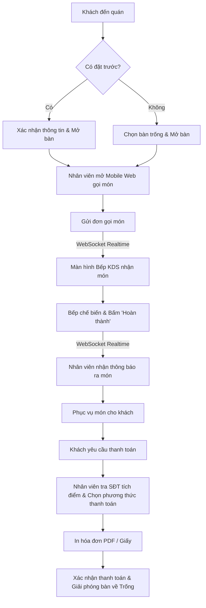
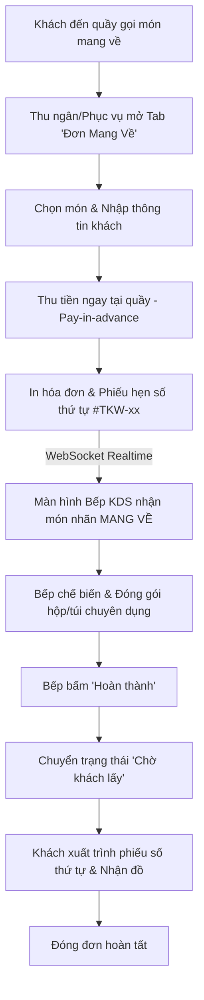
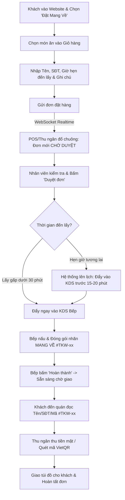
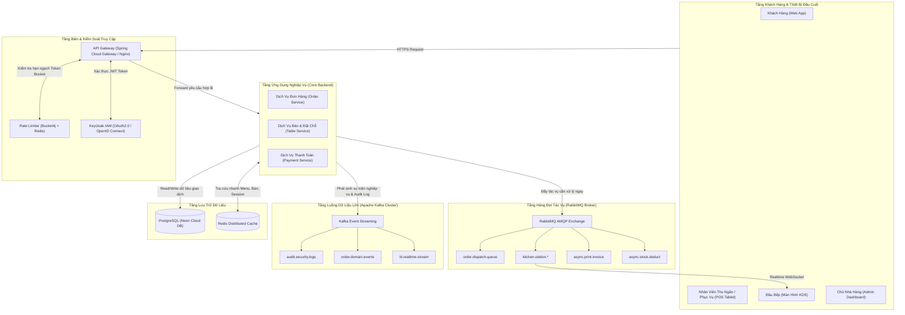

# TÀI LIỆU ĐẶC TẢ DỰ ÁN (PROJECT SPECIFICATION)

## ĐỒ ÁN 3: THIẾT KẾ VÀ XÂY DỰNG ỨNG DỤNG QUẢN LÝ NHÀ HÀNG

---

## 1. TỔNG QUAN DỰ ÁN

- **Tên đề tài:** Thiết kế và xây dựng ứng dụng quản lý nhà hàng (Restaurant Management System).
- **Mục tiêu:** Xây dựng hệ thống phần mềm toàn diện hỗ trợ vận hành quy trình nhà hàng: Đặt bàn, phục vụ tại bàn (Dine-in), đơn mang về (Takeaway), điều phối bếp realtime, thanh toán tại chỗ, tích điểm khách hàng và quản lý kho nguyên liệu.
- **Định hướng mở rộng:**
  - Kiến trúc hỗ trợ mở rộng chuỗi nhiều chi nhánh (Multi-branch) trong tương lai thông qua trường `branch_id`.
  - Sẵn sàng tích hợp dịch vụ phụ trợ / AI (gợi ý món ăn, dự đoán lượng nguyên liệu tiêu thụ) qua REST API độc lập.

---

## 2. NGĂN XẾP CÔNG NGHỆ (TECH STACK)

| Thành phần                  | Công nghệ lựa chọn                                | Mô tả chi tiết                                                                                                       |
| :-------------------------- | :------------------------------------------------ | :------------------------------------------------------------------------------------------------------------------- |
| **Backend Core**            | **Java 17/21 + Spring Boot 3**                    | Framework mạnh mẽ, cấu trúc chặt chẽ, phù hợp tiêu chuẩn học thuật & doanh nghiệp.                                   |
| **Bảo mật & Auth Core**     | **Spring Security + JWT**                         | Xác thực phân quyền không lưu trạng thái (Stateless Authentication).                                                 |
| **Quản lý Định danh (IAM)** | **Keycloak (OAuth2.0 / OIDC)**                    | Định danh tập trung, Single Sign-On (SSO), xác thực 2 bước (MFA), phân quyền Role linh hoạt.                         |
| **Hàng đợi Thông điệp**     | **RabbitMQ**                                      | Message Broker xử lý hàng đợi, đệm tải giờ cao điểm (Traffic Buffer), điều phối mẻ nấu KDS & in ấn bất đồng bộ.      |
| **Event Streaming & Audit** | **Apache Kafka**                                  | Xử lý luồng sự kiện phân tán thông lượng cao, lưu vết Audit Log bất biến chống gian lận và phân tích thời gian thực. |
| **Bộ đệm & Quản lý Tải**    | **Redis + Bucket4j / Gateway**                    | Distributed In-memory Cache, kiểm soát lưu lượng truy cập (Rate Limiting Token Bucket), chống Brute-force/DDoS.      |
| **Giao tiếp Real-time**     | **Spring WebSocket + STOMP**                      | Truyền tải thông điệp hai chiều tức thì giữa Bàn - Bếp - Quản lý.                                                    |
| **Frontend Web**            | **Angular 17+ (TypeScript)**                      | Kiến trúc Component/Service rõ ràng, gõ tĩnh an toàn.                                                                |
| **Thư viện UI FE**          | **PrimeNG / Angular Material**                    | Cung cấp sẵn các Data Table, Form, Dialog, Card chuyên nghiệp.                                                       |
| **Cơ sở dữ liệu chính**     | **PostgreSQL**                                    | Đảm bảo tính toàn vẹn giao dịch (ACID), triển khai trên **Neon.tech**.                                               |
| **Lưu trữ hình ảnh**        | **Cloudinary API**                                | CDN lưu trữ và tối ưu hóa hình ảnh món ăn, tải nhanh, miễn phí.                                                      |
| **Đóng gói**                | **Docker & Docker Compose**                       | Đóng gói Backend, Frontend (Nginx), DB chạy nhất quán đa nền tảng.                                                   |
| **Triển khai Cloud**        | **Neon** (DB) + **Render** (BE) + **Vercel** (FE) | Giải pháp miễn phí tối ưu cho môi trường sinh viên.                                                                  |

---

## 3. PHÂN QUYỀN HỆ THỐNG (ROLE-BASED ACCESS CONTROL - RBAC)

Hệ thống thiết kế tối ưu với **4 vai trò** cốt lõi:

| Vai trò (Role)           | Mã quyền       | Trách nhiệm chính                                                                                           |
| :----------------------- | :------------- | :---------------------------------------------------------------------------------------------------------- |
| **Chủ nhà hàng (Admin)** | `ROLE_ADMIN`   | Toàn quyền hệ thống: Quản lý nhân sự, xem biểu đồ doanh thu, cấu hình chung, quản lý chi nhánh.             |
| **Quản lý (Manager)**    | `ROLE_MANAGER` | Quản lý thực đơn (giá, món), quản lý kho (nhập/xuất), theo dõi lịch đặt bàn, xử lý chiết khấu hóa đơn.      |
| **Nhân viên (Staff)**    | `ROLE_STAFF`   | **Kiêm nhiệm Phục vụ & Thu ngân**: Xem sơ đồ bàn, xếp bàn, gọi món tại bàn, nhận thanh toán và in tạm tính. |
| **Bếp / Bar (Chef)**     | `ROLE_CHEF`    | Sử dụng màn hình Bếp (KDS): Nhận đơn theo thời gian thực, cập nhật trạng thái chế biến, báo hết món.        |

---

## 4. DANH MỤC CHỨC NĂNG CHI TIẾT (FUNCTIONAL REQUIREMENTS)

### 4.1. Phân hệ Bàn & Đặt bàn (Table & Reservation)

- **Trang Web Public cho Khách hàng:** Giao diện cho phép khách ngoài Internet xem thực đơn và gửi form đặt bàn trước (Tên, SĐT, số khách, giờ đến, ghi chú).
- **Quản lý đặt bàn nội bộ:** Nhân viên/Quản lý nhận yêu cầu đặt bàn (trạng thái `PENDING`), bấm xác nhận và gán bàn tương ứng.
- **Sơ đồ bàn trực quan:** Hiển thị danh sách bàn theo khu vực/tầng với màu sắc trạng thái: _Trống (Xanh)_, _Có khách (Đỏ)_, _Đã đặt trước (Vàng)_.
- **Thao tác bàn:** Xếp bàn, đổi bàn cho khách, gộp bàn khi khách đi nhóm đông.

### 4.2. Phân hệ Thực đơn & Món ăn (Menu Management)

- Quản lý danh mục món (Khai vị, Món chính, Đồ uống, Tráng miệng).
- Quản lý món ăn: Tên, đơn giá, ảnh món (qua Cloudinary), trạng thái còn hàng / hết hàng.
- **Chính sách giá linh hoạt:**
  - Hỗ trợ giá gốc (`original_price`) để hiển thị giá gạch ngang khuyến mãi trên Menu.
  - Hỗ trợ đặt lịch hẹn giờ đổi giá (`scheduled_price`, `price_effective_date`) áp dụng từ ngày hôm sau, tránh xung đột các bàn đang ăn dở.
  - Giá của đơn hàng được chốt tại thời điểm gọi (`price_at_order`).
- Tùy chọn món (Modifiers): Mức đường, đá, ghi chú đặc biệt cho bếp (không cay, ít hành).

### 4.3. Phân hệ Gọi món & Màn hình Bếp (Order & Kitchen Display System - KDS)

- **Gọi món tại bàn (Phục vụ):** Chọn bàn -> Chọn món -> Nhập ghi chú -> Bấm "Gửi bếp".
- **Giao tiếp Realtime (WebSocket):**
  - Ngay khi nhân viên gửi order, màn hình Bếp tự động cập nhật danh sách món cần làm kèm âm thanh thông báo.
  - Bếp bấm chuyển trạng thái: `CHỜ NẤU (PENDING)` -> `ĐANG NẤU (COOKING)` -> `ĐÃ XONG (READY)`.
  - Khi món `ĐÃ XONG`, màn hình nhân viên phục vụ nhận được thông báo để bưng đồ ra bàn.
  - Bếp có nút "Báo hết món" -> Toàn bộ nhân viên phục vụ lập tức thấy món chuyển sang trạng thái tạm ngưng phục vụ.

### 4.4. Phân hệ Thanh toán & Khuyến mãi (Billing & Vouchers)

- Tính tổng tiền tự động: Tiền món ăn, giảm giá theo thành viên / điểm tích lũy.
- **Mã giảm giá (Vouchers):** Hỗ trợ áp dụng mã voucher (giảm theo % hoặc giảm số tiền cố định với ngưỡng đơn hàng tối thiểu).
- Chọn phương thức thanh toán: Tiền mặt, Chuyển khoản quét QR, Thẻ POS (ghi nhận sổ sách, không cần kết nối cổng thanh toán phức tạp).
- Xem trước và in hóa đơn (HTML/CSS chuẩn khổ giấy in nhiệt 80mm qua hộp thoại in hoặc xuất file PDF).
- Đóng đơn, giải phóng bàn về trạng thái _Trống_.

### 4.5. Phân hệ Khách hàng & Tích điểm (Loyalty Points)

- Tìm kiếm khách hàng qua Số điện thoại khi thanh toán.
- Tích điểm theo tỉ lệ cấu hình trong `restaurant_configs` (ví dụ: 100.000 VNĐ = 1 điểm).
- Dùng điểm tích lũy để trừ trực tiếp vào hóa đơn của lần ăn sau.
- Lưu vết hạn sử dụng của điểm tích lũy (`expired_at`) phục vụ chính sách điểm trong 1 năm.

### 4.6. Phân hệ Quản lý Kho (Inventory Management)

- Quản lý danh mục nguyên liệu (tên, đơn vị tính: kg, lít, hộp, số lượng tồn tối thiểu).
- Lập phiếu nhập kho (nhập nguyên liệu mới, ghi nhận giá nhập).
- Lập phiếu xuất kho thủ công (xuất hủy, hao hụt).
- Cảnh báo nguyên liệu sắp hết khi tồn kho < ngưỡng tối thiểu.
- _(Ghi chú mở rộng):_ Sẵn sàng bảng dữ liệu `Recipe` (định lượng món ăn) cho giai đoạn sau.

### 4.7. Phân hệ Báo cáo & Thống kê (Dashboard & Analytics)

- Biểu đồ doanh thu theo ngày / tuần / tháng.
- Thống kê top các món bán chạy nhất (Best sellers).
- Thống kê lượng hóa đơn và phương thức thanh toán phổ biến.

### 4.8. Phân hệ Đơn Mua Mang Về & Đặt Món Trực Tuyến (Takeaway & Online Pick-up Ordering)

- **Khách đến quán mua mang về (In-store Takeaway):**
  - Tích hợp tab riêng **"Đơn Mang Về" (Takeaway)** cạnh "Sơ đồ Bàn" trên cả giao diện POS Nhân viên phục vụ và Quầy Thu Ngân.
  - Tạo đơn nhanh không cần chiếm dụng bàn ăn thực tế (`table_id = NULL`), hệ thống tự động cấp mã số thứ tự lấy đồ ngắn gọn trong ngày (VD: `#TKW-01`, `#TKW-02`...).
  - **Chính sách thanh toán:** Thanh toán ngay tại quầy khi gọi món (_Pay-in-advance_), in hóa đơn kèm phiếu hẹn số thứ tự cho khách.
  - Theo dõi trực quan trạng thái: `ĐANG NẤU (Chờ bếp)` $\rightarrow$ `ĐÃ XONG (Chờ khách lấy)` $\rightarrow$ `ĐÃ GIAO (Hoàn tất)`.
- **Khách đặt món mang về qua Website (Online Takeaway Pick-up):**
  - Cung cấp cổng đặt hàng trực tuyến trên Public Web (vận hành song song với luồng Đặt bàn trước).
  - Khách hàng duyệt menu, chọn món vào giỏ, chọn **Giờ hẹn đến lấy** (`pickup_time`), nhập Tên và Số điện thoại liên hệ.
  - **Quy trình tiếp nhận & Duyệt đơn:**
    - Đơn hàng rơi vào trạng thái `CHỜ DUYỆT (PENDING_APPROVAL)` kèm chuông âm thanh cảnh báo tại POS/Thu ngân.
    - Nhân viên kiểm tra đơn và bấm "Duyệt đơn".
    - Hệ thống tự động canh lịch đẩy lệnh nấu vào KDS Bếp trước giờ hẹn lấy 15-20 phút (hoặc đẩy ngay nếu khách hẹn lấy gấp trong vòng 30 phút).
  - **Chính sách thanh toán:** Khách thanh toán khi đến quán nhận đồ (Tiền mặt hoặc Chuyển khoản VietQR hiển thị mã QR động).
- **Hiển thị & Đóng gói trên Màn hình Bếp (KDS):**
  - Món ăn thuộc đơn mang về được gắn nhãn nổi bật: Badge màu cam `[MANG VỀ]` kèm Mã lấy đồ `#TKW-xx` để đầu bếp đóng hộp/túi chuyên dụng thay vì bày lên đĩa ăn tại quán.
  - Bếp bấm "Hoàn thành" $\rightarrow$ Hệ thống cập nhật trạng thái `ĐÃ NẤU XONG (Chờ khách lấy)` tại quầy giao nhận.

---

## 5. CÁC LUỒNG NGHIỆP VỤ CỐT LÕI (CORE WORKFLOWS)

### 5.1. Luồng nghiệp vụ Khách Ăn Tại Bàn (Dine-in Workflow)

### 5.2. Luồng nghiệp vụ Khách Mua Mang Về Tại Quầy (In-store Takeaway)

### 5.3. Luồng nghiệp vụ Khách Đặt Món Mang Về Qua Web (Online Takeaway Pick-up)

---

## 6. THIẾT KẾ CƠ SỞ DỮ LIỆU CỐT LÕI (PREVIEW ENTITIES)

1. **`branches`**: `id`, `name`, `address`, `phone`, `is_active` _(Phục vụ mở rộng đa chi nhánh)_.
2. **`users`**: `id`, `branch_id`, `username`, `password`, `full_name`, `role`, `status`.
3. **`dining_tables`**: `id`, `branch_id`, `table_number`, `capacity`, `status` _(EMPTY, OCCUPIED, RESERVED)_.
4. **`reservations`**: `id`, `branch_id`, `customer_name`, `phone`, `table_id`, `reservation_time`, `guest_count`, `status`.
5. **`categories`**: `id`, `name`, `description`.
6. **`dishes`**: `id`, `category_id`, `name`, `price`, `image_url`, `is_available`.
7. **`orders`**: `id`, `branch_id`, `table_id` _(NULL nếu là đơn mang về)_, `staff_id`, `customer_id`, `customer_name`, `phone`, `order_type` _(DINE_IN, TAKEAWAY_STORE, TAKEAWAY_WEB)_, `order_code` _(Mã đơn hệ thống)_, `pickup_code` _(Số thứ tự lấy đồ ngắn gọn trong ngày: #TKW-01)_, `pickup_time` _(Giờ hẹn đến lấy đối với đơn Web)_, `payment_status` _(UNPAID, PAID)_, `approval_status` _(PENDING, APPROVED, REJECTED)_, `status` _(PENDING, COOKING, READY, COMPLETED, CANCELLED)_, `total_amount`, `notes`, `created_at`.
8. **`order_items`**: `id`, `order_id`, `dish_id`, `quantity`, `price`, `notes`, `kitchen_status` _(PENDING, COOKING, READY, SERVED)_.
9. **`bills`**: `id`, `order_id`, `customer_id`, `total_amount`, `discount_amount`, `final_amount`, `payment_method` _(CASH, TRANSFER, POS)_, `created_at`.
10. **`customers`**: `id`, `full_name`, `phone`, `points`.
11. **`inventory_items`**: `id`, `branch_id`, `name`, `unit`, `current_stock`, `min_threshold`.
12. **`stock_transactions`**: `id`, `inventory_item_id`, `type` _(IN, OUT)_, `quantity`, `created_by`, `created_at`.
13. **`recipes`** _(Dự phòng mở rộng)_: `dish_id`, `inventory_item_id`, `quantity_needed`, `wastage_percentage`.
14. **`work_shifts`** _(Mở rộng xếp ca)_: `id`, `branch_id`, `name`, `start_time`, `end_time`, `min_staff`.
15. **`staff_unavailability`** _(Mở rộng xếp ca)_: `id`, `user_id`, `shift_id`, `unavailable_date`, `reason`, `status`.
16. **`shift_assignments`** _(Mở rộng xếp ca)_: `id`, `user_id`, `shift_id`, `work_date`, `role_in_shift`, `status`.

---

## 7. KẾ HOẠCH THỰC HIỆN DỰ ÁN (PROJECT TIMELINE - 6 TUẦN)

|    Tuần    | Giai đoạn                                        | Mục tiêu chi tiết                                                                                                                                                                                                                                                                                                                                          | Kết quả đầu ra (Deliverables)                                                         |
| :--------: | :----------------------------------------------- | :--------------------------------------------------------------------------------------------------------------------------------------------------------------------------------------------------------------------------------------------------------------------------------------------------------------------------------------------------------- | :------------------------------------------------------------------------------------ |
| **Tuần 1** | **Khởi tạo & Thiết kế**                          | - Chốt tài liệu đặc tả (SRS). - Thiết kế chi tiết CSDL PostgreSQL. - Khởi tạo Repo Git, cấu hình Spring Boot + Angular + Docker Compose.                                                                                                                                                                                                             | - File thiết kế CSDL (.sql / DDL). - Project skeleton BE & FE chạy thử thành công. |
| **Tuần 2** | **Xác thực & Danh mục nền tảng**                 | - Xây dựng Spring Security + JWT, phân quyền 4 Roles. - CRUD Quản lý Bàn, Danh mục, Món ăn. - Tích hợp Cloudinary upload ảnh món ăn. - Xây dựng giao diện Đăng nhập, Quản lý Bàn, Menu (Angular).                                                                                                                                                 | - Đăng nhập phân quyền hoạt động. - Quản lý menu & hình ảnh trơn tru.              |
| **Tuần 3** | **Luồng Gọi món & Bếp Realtime**                 | - API tạo Đơn (Order) & Chi tiết món (Order Items). - Tích hợp Spring WebSocket (STOMP). - FE: Giao diện gọi món trên thiết bị di động (Responsive). - FE: Giao diện Màn hình Bếp (KDS) tự động nhảy đơn.                                                                                                                                         | - Demo được luồng: Nhân viên bấm đặt món -> Bếp nhận ngay lập tức qua WebSocket.      |
| **Tuần 4** | **Thanh toán, In Bill, Tích điểm & Đơn Mang Về** | - Xử lý tính toán hóa đơn, tích & trừ điểm khách hàng. - Chọn phương thức thanh toán & Đóng bàn. - Giao diện xem trước và in hóa đơn (PDF / Print layout). - Phân hệ Đặt bàn trước (Reservation) & Đặt món mang về qua Web (Online Takeaway Pick-up). - Quản lý tab Đơn Mang Về trên POS & Thu ngân (cấp mã #TKW-xx, Pay-in-advance tại quầy). | - Hoàn tất chu trình ăn tại chỗ và bán mang về từ Web/Quầy.                           |
| **Tuần 5** | **Quản lý Kho & Báo cáo Doanh thu**              | - API & UI quản lý nguyên liệu, phiếu nhập kho, phiếu xuất kho. - Cảnh báo tồn kho dưới ngưỡng. - Dashboard thống kê doanh thu theo thời gian, top món bán chạy (Chart.js / PrimeNG Charts).                                                                                                                                                         | - Phân hệ kho và báo cáo hoàn chỉnh.                                                  |
| **Tuần 6** | **Tối ưu, Đóng gói, Deploy & Báo cáo**           | - Đóng gói hoàn chỉnh qua Docker Compose. - Triển khai lên Cloud: Neon (DB), Render (BE), Vercel (FE). - Kiểm thử luồng tích hợp, sửa lỗi giao diện. - Viết báo cáo Đồ án 3 và slide thuyết trình.                                                                                                                                                | - Link web chạy demo trực tuyến. - Báo cáo và slide sẵn sàng bảo vệ.               |

---

## 8. MÔ HÌNH TOÁN HỌC & CÁC THUẬT TOÁN ÁP DỤNG TRONG DỰ ÁN

### 8.1. Thuật toán Trọng tâm cho Đồ án 3: Lập lịch Bếp & Gom mẻ theo SLA & Chuỗi món (KDS Table SLA Pacing & Batching)

- **Bài toán Nghiệp vụ Thực tế:**
  1. **Nghẽn bàn lớn vs Bàn nhỏ (Table Size SLA & Pacing):** Nếu áp dụng FIFO ngây thơ, một bàn tiệc 12 người đặt trước 15 món sẽ chiếm dụng toàn bộ công suất bếp. Bàn 2-4 người vào sau chỉ gọi 3-4 món đơn giản nhưng phải đợi 35-40 phút, gây bức xúc và giảm vòng quay bàn (Table Turnover).
  2. **Đồng bộ thời điểm ra món ("All Items Ready Together" / Target Delivery Time):** Nếu chỉ ưu tiên món làm nhanh (Shortest Processing Time - SPT), các món nấu nhanh sẽ ra bàn trước và bị nguội ngắt, trong khi món nấu lâu (Lẩu 15p, Nướng 18p, Bít tết) bị dìm xuống cuối làm khách phải chờ dài cổ. Vì vậy, các món nấu lâu cần có **áp lực thời gian (Time Pressure)** cao hơn để được khởi động sớm, đảm bảo toàn bộ món mặn của bàn hoàn thành đồng bộ cùng một nhịp.
  3. **Chuỗi thứ tự món ăn (Course Serving Sequence):** 
     - *Khai vị & Đồ uống:* Cần lên bàn ngay trong 3-5 phút đầu để khách nhâm nhi mở màn.
     - *Món tráng miệng (Kem, Chè, Hoa quả):* Tuyệt đối không được làm hoặc mang ra trước khi khách ăn xong món chính (tránh kem bị chảy, chè tan đá làm hỏng trải nghiệm ẩm thực).

- **Mô hình Toán học Tính Điểm Ưu Tiên Động (Dynamic Weighted Priority Score):**
  $$\text{Priority Score} = \text{TimePressureScore} + \text{AgingScore} + \text{SmallTableBonus} + \text{BatchBonus} + \text{StatusBonus} + \text{CourseBonus}$$

  Trong đó:
  1. **Phân loại Target SLA & Thưởng Bàn nhỏ theo Dung lượng ($C$):**
     - $C \le 4$ người (Bàn nhỏ 2-4 khách): $\text{SLA} = 20.0$ phút; $\text{SmallTableBonus} = +6.0$ điểm (ưu tiên giải phóng bàn nhanh, tăng vòng quay bàn).
     - $5 \le C \le 8$ người (Bàn vừa 6 khách): $\text{SLA} = 25.0$ phút; $\text{SmallTableBonus} = +3.0$ điểm.
     - $C > 8$ người (Bàn lớn / Bàn tiệc đoàn đông): $\text{SLA} = 30.0$ phút; $\text{SmallTableBonus} = 0.0$ điểm.

  2. **Điểm Áp lực Thời gian Hoàn thành (Time Pressure Score):**
     $$\text{EstimatedFinish} = T_{\text{wait}} + T_{\text{prep}}$$
     $$\text{TimePressureScore} = \left(\frac{T_{\text{wait}} + T_{\text{prep}}}{\text{SLA}}\right) \times 50.0$$
     - Món nấu lâu ($T_{\text{prep}} = 15-18$ phút) sẽ có tỷ lệ áp lực tiệm cận 80-90% SLA ngay từ phút đầu tiên, do đó tự động được đẩy lên làm sớm để kịp ra bàn đúng hạn chót SLA.

  3. **Điểm Chống Đói Tiến trình (Aging Score):**
     $$\text{AgingScore} = T_{\text{wait}} \times 1.5$$
     - Mỗi phút trôi qua cộng thêm 1.5 điểm, đảm bảo mọi món chờ lâu đều sẽ tích lũy điểm và vươn lên đầu danh sách.

  4. **Thuật toán Gom mẻ Thông minh (Greedy Batching Bonus):**
     $$\text{BatchBonus} = N_{\text{batch}} \times 5.0 \quad (\text{khi } N_{\text{batch}} > 1)$$
     - Quét toàn bộ các món cùng loại (`dish_id`) đang chờ trong hệ thống để gộp nấu 1 mẻ, tiết kiệm công suất bếp và thời gian chảo.

  5. **Điểm Trạng thái Đặc biệt (Status Override):**
     - $\text{CANCEL\_REQUESTED}$: $+100.0$ điểm (Ưu tiên tuyệt đối lên đầu để cảnh báo đầu bếp dừng tay, tránh lãng phí nguyên liệu).
     - $\text{COOKING}$: $+50.0$ điểm (Ưu tiên đầu bếp tập trung hoàn thiện dứt điểm món đang dở trước khi chuyển sang món mới).

  6. **Điều phối Chuỗi Món Ăn (Course Serving Sequence):**
     - *Khai vị & Đồ uống Bar:* $\text{CourseBonus} = +18.0$ điểm (phục vụ mở đầu bữa ăn).
     - *Món Tráng miệng (Dessert):*
       - Khi bàn **vẫn còn món chính** đang chờ hoặc đang nấu: $\text{CourseBonus} = -100.0$ điểm (ghim chắc chắn ở đáy danh sách).
       - Khi bàn **đã nấu xong hết món chính**: $\text{CourseBonus} = +15.0$ điểm (tự động kích hoạt làm ngay để chuyển lên bàn cho khách).

---

### 8.2. Danh mục Thuật toán & Bài toán Mở rộng (Dành cho Kì sau / Đồ án Tốt nghiệp)

|  STT  | Bài toán nghiệp vụ                             | Mô hình / Thuật toán phù hợp                                                 | Mục tiêu & Lợi ích                                                                                                                                                                                                           |
| :---: | :--------------------------------------------- | :--------------------------------------------------------------------------- | :--------------------------------------------------------------------------------------------------------------------------------------------------------------------------------------------------------------------------- |
| **1** | **Dự báo nhu cầu & Tiêu thụ nguyên liệu**      | **Time Series Forecasting (SARIMA, Facebook Prophet, LSTM, XGBoost)**        | Dự đoán số lượng từng món ăn bán ra trong ngày/tuần tới dựa trên: thứ trong tuần, thời tiết (nắng/mưa/nhiệt độ), sự kiện/ngày lễ ➔ Tự động tính toán lượng thịt, rau cần nhập, tránh thiếu nguyên liệu hoặc tồn kho ôi thiu. |
| **2** | **Quản lý tồn kho tối ưu & Điểm đặt hàng lại** | **EOQ (Economic Order Quantity) & Safety Stock Model**                       | Tính toán chính xác số lượng nguyên liệu tối ưu mỗi lần nhập và điểm tái đặt hàng (Reorder Point - ROP) để tối thiểu hóa tổng chi phí lưu kho và chi phí đặt hàng.                                                           |
| **3** | **Định giá động (Dynamic Pricing)**            | **Multi-Armed Bandit / Q-Learning (Reinforcement Learning)**                 | Tự động điều chỉnh mức chiết khấu/khuyến mãi theo khung giờ (Happy Hour vắng khách thì giảm 15-20% để kích cầu; giờ cao điểm cuối tuần quay về giá gốc).                                                                     |
| **4** | **Trợ lý ảo AI tư vấn Menu & Đặt bàn**         | **LLM RAG (Retrieval-Augmented Generation) + NLP**                           | Chatbot thông minh tích hợp trên Web/Messenger trả lời câu hỏi tự nhiên: _"Gợi ý bữa ăn 4 người dưới 600k không cay"_ ➔ Tra cứu thực đơn trong database, gợi ý combo và tự động tạo đơn đặt bàn.                             |
| **5** | **Xếp ca làm việc tự động cho nhân viên**      | **Constraint Satisfaction Problem (CSP) / Integer Linear Programming (ILP)** | Tự động chia ca làm việc hàng tuần cho nhân viên theo nguyện vọng đăng ký, đảm bảo: đủ số lượng từng vai trò (bếp, phục vụ), không vi phạm luật lao động (tối đa 8h/ngày, không làm 2 ca đêm liên tiếp).                     |
| **6** | **Gợi ý món ăn kèm (Cross-selling)**           | **Apriori / Association Rule Mining / Collaborative Filtering**              | Phân tích giỏ hàng khách cũ để gợi ý: _"Khách ăn Lẩu Thái thường uống kèm Bia Heineken hoặc gọi thêm Tôm sú"_.                                                                                                               |

---

## 9. KIẾN TRÚC MỞ RỘNG DOANH NGHIỆP: QUẢN LÝ XÁC THỰC (IAM), HÀNG ĐỢI & ĐIỀU TIẾT TẢI TRUY CẬP (ENTERPRISE ARCHITECTURE)

Nhằm đáp ứng yêu cầu vận hành chuỗi nhà hàng quy mô lớn với hàng ngàn yêu cầu gọi món đồng thời trong các khung giờ cao điểm (Peak Rush Hours: 11h30 - 13h30 và 18h30 - 20h30), hệ thống được mở rộng kiến trúc với các giải pháp công nghệ phân tán chuyên sâu: **Keycloak**, **RabbitMQ**, **Apache Kafka**, và **Redis Rate Limiting / API Gateway**.

### 9.1. Quản lý Định danh & Xác thực Tập trung (Identity & Access Management - Keycloak)

#### 9.1.1. Bối cảnh & Lý do lựa chọn

Trong mô hình cơ bản, mã nguồn Spring Boot tự quản lý bảng `users`, mã hóa `BCrypt` mật khẩu và sinh mã JWT thủ công. Khi hệ thống mở rộng sang mô hình chuỗi hoặc tách microservices:

- Mỗi dịch vụ phải tự cài đặt logic xác thực gây phân tán và trùng lặp.
- Khó kiểm soát và thu hồi quyền tức thời khi nhân viên thôi việc.
- Thiếu các tính năng doanh nghiệp: SSO (Single Sign-On), MFA (xác thực đa yếu tố), quản lý vòng đời tài khoản tập trung.

**Keycloak** (phát triển bởi Red Hat) được tích hợp làm Identity Provider (IdP) độc lập tuân thủ chuẩn công nghiệp **OAuth 2.0** và **OpenID Connect (OIDC)**.

#### 9.1.2. Kiến trúc Phân quyền & Quản lý Realm

- **Realm Nhà hàng (`nomnom-restaurant`):** Không gian bảo mật cách ly chứa toàn bộ người dùng, quyền hạn và chính sách đăng nhập của chuỗi quán ăn.
- **Cấu hình Client:**
  - `nomnom-frontend`: Public Client (Angular SPA) sử dụng luồng xác thực an toàn **Authorization Code Flow with PKCE (Proof Key for Code Exchange)**, ngăn chặn rò rỉ secret trên trình duyệt client.
  - `nomnom-backend-api`: Resource Server xác thực bearer token JWT trên mỗi request.
- **Đồng bộ RBAC với nghiệp vụ:**
  - Realm Roles & Client Roles: Gán linh hoạt `ROLE_ADMIN`, `ROLE_MANAGER`, `ROLE_STAFF`, `ROLE_CHEF`.
  - Hỗ trợ gán nhiều vai trò cùng lúc (ví dụ: Quản lý kiêm Thu ngân khi nhà hàng vắng người).
- **Quản lý Vòng đời Token:**
  - **Access Token (Ngắn hạn - 5 đến 15 phút):** Chứa thông tin người dùng (`sub`), vai trò (`roles`), mã chi nhánh (`branch_id`). Được Resource Server xác thực qua Public Key (JWKS) mà không cần gọi ngược về Keycloak.
  - **Refresh Token (Dài hạn - 8 đến 24 giờ):** Lưu tại HTTP-Only Cookie hoặc bộ nhớ an toàn để tự động gia hạn Access Token ngầm dưới nền mà người dùng không bị văng đăng xuất giữa ca làm việc.
  - **Thu hồi quyền tức thì (Backchannel Logout & Token Revocation):** Khi nhân viên bị khóa tài khoản hoặc thu hồi quyền khẩn cấp, Keycloak phát tín hiệu Backchannel Logout đến Backend và ghi `jti` (JWT ID) vào Redis Blacklist để hủy hiệu lực ngay lập tức mà không cần chờ Access Token hết hạn.
- **Bảo mật Nâng cao:**
  - **Brute-Force Detection:** Tự động khóa tạm thời tài khoản 15 phút sau 5 lần nhập sai mật khẩu liên tiếp.
  - **MFA (Multi-Factor Authentication):** Bắt buộc kích hoạt mã OTP (Google Authenticator / FreeOTP) đối với tài khoản `ROLE_ADMIN` và `ROLE_MANAGER` khi truy cập cấu hình hệ thống và dữ liệu doanh thu.

---

### 9.2. Hàng đợi Thông điệp & Điều phối Tải tức thì (Message Queue - RabbitMQ)

#### 9.2.1. Bối cảnh & Vai trò "Bộ giảm chấn" (Traffic Shock Absorber)

Vào các khung giờ cao điểm (12h trưa hoặc 19h tối), hàng chục bàn gọi món dồn dập cùng lúc. Nếu Backend xử lý đồng bộ trực tiếp xuống Database và các thiết bị ngoại vi:

1. Thread Pool của máy chủ Web nhanh chóng cạn kiệt, dẫn đến lỗi treo đơ giao diện (`504 Gateway Timeout`).
2. Tác vụ in hóa đơn (máy in nhiệt kết nối LAN/USB) hoặc trừ tồn kho nguyên liệu (tính toán định lượng BOM phức tạp) làm nghẽn tiến trình phản hồi của nhân viên phục vụ.

**RabbitMQ** (giao thức AMQP) đóng vai trò Message Broker với độ trễ cực thấp (< 5ms), đảm bảo tính toàn vẹn thông điệp và cân bằng tải tác vụ.

#### 9.2.2. Thiết kế Hàng đợi & Luồng Điều phối

1. **Bộ đệm tiếp nhận đơn gọi món (`order.dispatch.queue`):**
   - Khi nhân viên bấm "Gửi Bếp", REST API phản hồi HTTP `202 Accepted` ngay trong 50ms sau khi đẩy payload đơn hàng vào RabbitMQ.
   - Các Worker tiến hành ghi nhận vào CSDL theo tốc độ xử lý an toàn của PostgreSQL, triệt tiêu nguy cơ nghẽn kết nối database.
2. **Điều phối trạm bếp (`kitchen.station.exchange` - Topic Exchange):**
   - Định tuyến tự động từng món ăn theo mã trạm:
     - `kitchen.hot` $\rightarrow$ Hàng đợi Bếp Xào / Bếp Nóng.
     - `kitchen.cold` $\rightarrow$ Hàng đợi Bếp Salad / Nguội.
     - `kitchen.grill` $\rightarrow$ Hàng đợi Trạm Nướng.
     - `kitchen.bar` $\rightarrow$ Hàng đợi Quầy Pha Chế.
   - Mỗi trạm có Consumer độc lập, hiển thị tức thì trên màn hình KDS thông qua WebSocket.
3. **Xử lý In ấn Ngoại vi Bất đồng bộ (`async.print.invoice`):**
   - Khi hoàn tất thanh toán, lệnh in bill được đẩy vào queue in nhiệt. Dù máy in hết giấy hoặc kẹt giấy, quy trình thanh toán trên máy POS vẫn hoàn tất suôn sẻ, không làm gián đoạn việc tiếp đón lượt khách kế tiếp.
4. **Cơ chế Đảm bảo Tin cậy & Xử lý Lỗi (Message ACK & Dead Letter Exchange - DLX):**
   - **Manual Acknowledgement (`basic.ack`):** Chỉ xác nhận thông điệp đã hoàn tất sau khi worker thực thi thành công.
   - **Dead Letter Queue (`order.dlq`):** Nếu một tác vụ gặp lỗi ngoại lệ liên tục 3 lần (ví dụ: máy in ngắt kết nối, lỗi mạng nội bộ), thông điệp tự động đẩy về DLQ để quản trị viên kiểm tra, không làm thất lạc bất kỳ thông tin đơn hàng nào.

---

### 9.3. Nền tảng Luồng Sự kiện Phân tán & Lưu vết Dữ liệu Lớn (Apache Kafka)

#### 9.3.1. Phân biệt vai trò: Khi nào dùng RabbitMQ và khi nào dùng Apache Kafka?

- **RabbitMQ:** Tối ưu cho xử lý tác vụ theo dạng hàng đợi (Task Queues), "giao việc và xóa bỏ sau khi làm xong", ưu tiên tốc độ tức thời và routing linh hoạt cho nghiệp vụ KDS Bếp & In ấn nội bộ.
- **Apache Kafka:** Tối ưu cho việc lưu giữ luồng sự kiện phân tán dung lượng lớn (Distributed Event Log), dữ liệu được lưu trữ vĩnh viễn theo thời gian (Event Sourcing / Log Retention), hỗ trợ nhiều dịch vụ khác nhau đọc lại sự kiện (Replay Events) mà không phụ thuộc lẫn nhau.

#### 9.3.2. Danh mục Topic Kafka Trọng tâm

1. **Luồng sự kiện đơn hàng & thanh toán (`restaurant.orders.events`):**
   - Lưu trữ các sự kiện bất biến: `OrderCreated`, `OrderItemAdded`, `OrderItemVoided` (Hủy món), `BillSettled`.
   - Cho phép các dịch vụ phân tích tính toán doanh thu tổng hợp theo từng giây mà không cần truy vấn khóa bảng (lock table) trên CSDL PostgreSQL chính.
2. **Nhật ký kiểm toán an ninh chống gian lận (`restaurant.audit.logs`):**
   - Ghi nhận toàn bộ thao tác nhạy cảm: Giảm giá bill đặc biệt, áp voucher lớn, xóa món sau khi bếp đã nấu, mở ngăn kéo đựng tiền ngoài ca.
   - Apache Kafka tiếp nhận thông lượng hàng ngàn bản ghi audit log/giây mà không làm ảnh hưởng hiệu năng hệ thống. Dữ liệu audit log không thể chỉnh sửa (Append-only Log), phục vụ thanh tra và đối soát tài chính minh bạch.
3. **Luồng tích hợp Phân tích Dữ liệu Thời gian thực (Real-time BI & AI Streaming):**
   - Đẩy dòng dữ liệu gọi món sang mô hình máy học (AI Recommendation Model) để dự báo sức mua tức thời và gợi ý nhập thực phẩm theo thời gian thực (Real-time Demand Forecasting).

---

### 9.4. Kiểm soát Lượng Truy cập & Chống Quá tải (Traffic Control, Concurrency & Rate Limiting)

#### 9.4.1. Nguy cơ tiềm ẩn về tải

- **Tấn công từ chối dịch vụ (DDoS) / Brute-Force:** Kẻ xấu spam request liên tục vào API đăng nhập hoặc API kiểm tra số điện thoại khách hàng.
- **Spam đặt bàn online:** Người dùng ngoài Internet dùng tool bot gửi hàng trăm yêu cầu đặt bàn ảo làm tràn ngập dữ liệu `reservations`.
- **Hiện tượng Thundering Herd:** Khi nhà hàng chạy chương trình khuyến mãi lớn (ví dụ: _"Giờ vàng 12h trưa giảm 50%"_), hàng ngàn khách cùng lúc truy cập xem thực đơn và đặt chỗ.

#### 9.4.2. Cơ chế Bảo vệ Đa tầng (Defense in Depth)

1. **Cổng API Gateway (Spring Cloud Gateway):**
   - Nằm tại cửa ngõ vào của hệ thống, thực hiện SSL Termination, giải mã & xác thực sơ bộ JWT Token, định tuyến động (Dynamic Routing) và nén dữ liệu truyền tải (Gzip compression).

2. **Thuật toán Token Bucket Phân tán (Distributed Token Bucket với Bucket4j + Redis):**
   - **Nguyên lý:** Mỗi Client (nhận diện theo IP hoặc User Token) sở hữu một "thùng token" có sức chứa $C$ (Capacity). Token được bổ sung đều đặn theo tốc độ $r$ (Refill Rate) mỗi giây. Mỗi request đến phải tiêu thụ 1 token. Nếu thùng hết token, request bị từ chối ngay lập tức với mã lỗi `HTTP 429 Too Many Requests`.
   - **Chính sách phân hạn ngạch (Tiered Rate Limits):**

| Đối tượng / Endpoint                  | Cơ chế nhận diện   | Hạn mức cấu hình (Token Bucket)                      | Mục đích bảo vệ                                                                                                             |
| :------------------------------------ | :----------------- | :--------------------------------------------------- | :-------------------------------------------------------------------------------------------------------------------------- |
| **API Công khai (Xem Menu, Đặt bàn)** | Địa chỉ IP Client  | $30\text{ req/phút}$, Burst tối đa $50\text{ req}$   | Ngăn chặn bot cào dữ liệu (scraping) và spam đơn đặt bàn ảo.                                                                |
| **API Xác thực (`/api/auth/login`)**  | Địa chỉ IP Client  | $5\text{ req/phút}$, Khóa $15\text{ phút}$ nếu vượt  | Triệt tiêu hoàn toàn tấn công dò mật khẩu (Brute-Force & Credential Stuffing).                                              |
| **API Thu ngân & POS Bàn**            | User Token (`sub`) | $300\text{ req/phút}$, Burst tối đa $500\text{ req}$ | Đảm bảo tốc độ phục vụ nhanh nhất cho nhân viên, đồng thời ngăn chặn vòng lặp vô tận (infinite loop) nếu có lỗi ở frontend. |
| **API Màn hình Bếp (KDS)**            | Trạm Bếp Token     | $120\text{ req/phút}$                                | Đảm bảo cập nhật trạng thái chế biến mượt mà, ổn định đường truyền mạng nội bộ.                                             |

3. **Cơ chế Ngắt mạch & Tự phục hồi (Circuit Breaker với Resilience4j):**
   - Được áp dụng cho các điểm tích hợp dịch vụ bên ngoài: Cổng thanh toán trực tuyến (VNPay / MoMo), hệ thống gửi SMS Brandname, Cloudinary Image CDN.
   - **Trạng thái hoạt động:**
     - `CLOSED` (Bình thường): Mọi request gửi đến dịch vụ đối tác.
     - `OPEN` (Ngắt mạch): Khi tỷ lệ gọi lỗi của bên thứ 3 vượt quá $50\%$ trong cửa sổ 10 giây. Hệ thống tự động chuyển hướng sang kịch bản dự phòng (Fallback) ngay trong 1ms thay vì bắt luồng POS phải chờ timeout 30 giây: _"Cổng thanh toán điện tử đang bảo trì, hệ thống tự động chuyển sang chế độ thanh toán tiền mặt/chuyển khoản QR ngân hàng"_.
     - `HALF-OPEN` (Thử nghiệm hồi phục): Sau 60 giây, cho phép một số lượng nhỏ request thử nghiệm qua. Nếu thành công, tự động đóng mạch về trạng thái `CLOSED`.

---
